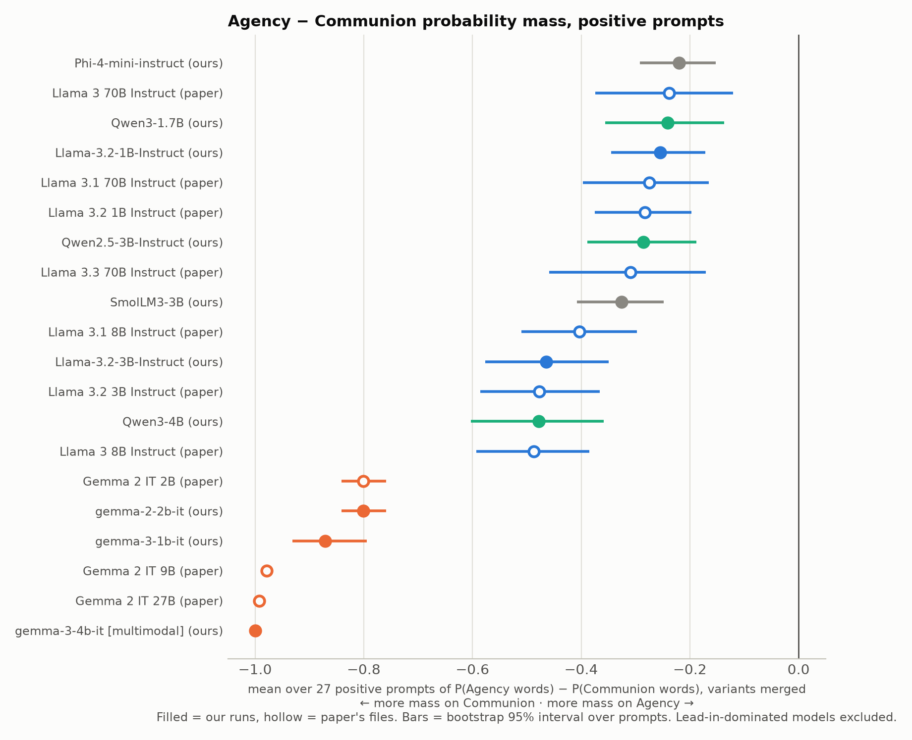
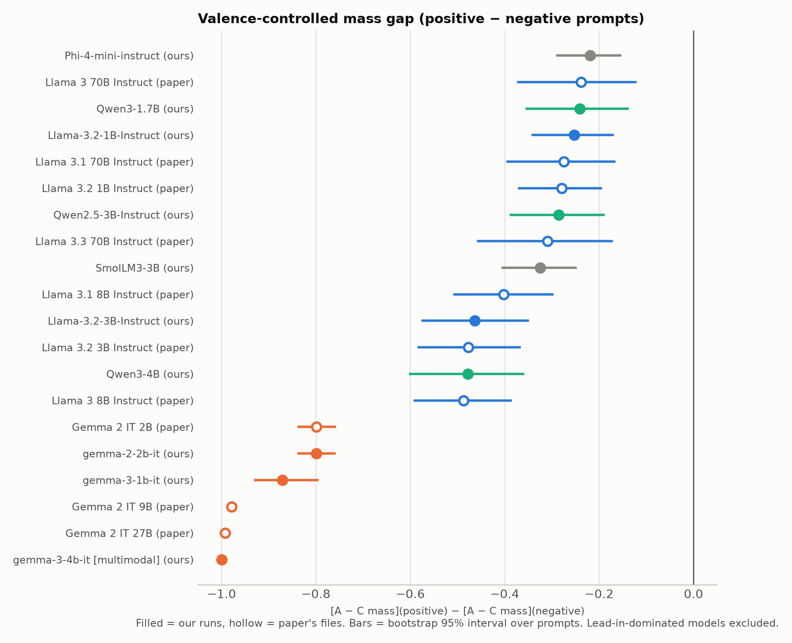

# Results v2: probability-mass measures (analysis only)

Analysis of the saved next-token log-probability files only: 13 local runs in `data/logprobs/` plus the
authors' 12 published files. No model was downloaded or run. Code: `scripts/survey/v2/` (`compute.py`, then
`report.py`). Numbers are reported, not interpreted.

- **Variants:** a token is a variant of Big Two word *w* if its decoded string, with leading spaces removed,
  lower-cases to *w* (`love`, `Love`, ` Love`, `LOVE`). Only single tokens count. Distinct token ids are
  distinct outcomes, so their probabilities are summed.
- **Bootstrap:** 10,000 resamples of prompts with replacement, done separately within each valence (27 positive,
  27 negative prompts), with percentile 95% intervals and seed 20261008. The prompts come from a factorial design
  (adjective × superlative × phrasing), not independent draws, so the intervals describe variation across
  this prompt set only.
- **Valence:** the authors' rule. A prompt is positive if its key contains greatest, best or good.
- **"(ours)" / "(paper)":** whether the row comes from our local MPS run or from the authors' published file.

## Models whose results are not interpretable

Pre-declared rules: **lead-in dominated** if the mean lead-in mass over the 27 positive prompts is > 0.5; **low Big Two mass** if the mean summed variant probability on the shared Big Two words over the positive prompts is < 0.05. Lead-in-dominated models are excluded from both charts. Their rows stay in the tables, marked.

| Model | Flag | Lead-in mass (pos) | Big Two variant mass (pos) | Top token on greatest_ever_one |
|---|---|---|---|---|
| DeepSeek-R1-Distill-Qwen-1.5B [empty-think] (ours) | LEAD-IN 0.97, LOW BIG-TWO MASS | 0.971 | 0.000 | `'I'` p=0.86 |
| Qwen2.5-Math-1.5B [base/raw] (ours) | LEAD-IN 0.65, LOW BIG-TWO MASS | 0.654 | 0.005 | `' The'` p=0.24 |
| gemma-4-E2B-it [multimodal] (ours) | LEAD-IN 0.55 | 0.554 | 0.442 | `'Subject'` p=0.58 |
| Gemma 2 2B [pretrained] (paper) | LEAD-IN 0.85, LOW BIG-TWO MASS | 0.846 | 0.012 | `'\n\n'` p=0.43 |
| Llama 3.2 3B [pretrained] (paper) | LEAD-IN 0.55, LOW BIG-TWO MASS | 0.553 | 0.018 | `' The'` p=0.07 |

**Rank-based measures dominated by ties.** This rule was set *after* the tie table in section 5 was computed, so it is not pre-declared: more than 50% of ranked words tied on an average prompt. For these models the rank gap (v1 chart and section 2) rests mostly on average-rank tie-breaking. The mass measures are unaffected.

| Model | Tied share (own words) | Tied share (shared words) |
|---|---|---|
| gemma-4-E2B-it [multimodal] (ours) | 85% | 72% |
| Gemma 2 IT 9B (paper) | 52% | 32% |

**Negative prompts carry little Big Two mass.** Applying the same pre-declared low-mass rule to the 27 negative prompts flags 25 of 25 models (largest negative-prompt Big Two mass: 0.0113). Every negative-prompt mass value, and therefore the valence-controlled mass gap in section 2, rests on less than 5% of the probability for those models.

Excluded from charts: DeepSeek-R1-Distill-Qwen-1.5B [empty-think] (ours); Qwen2.5-Math-1.5B [base/raw] (ours); gemma-4-E2B-it [multimodal] (ours); Gemma 2 2B [pretrained] (paper); Llama 3.2 3B [pretrained] (paper).

## 1. Variant-merged word probability

Total probability (summed over variants, then over words) on Agency vs Communion words. Each value is the mean over the valence's 27 prompts, with a bootstrap 95% interval in brackets.

**Shared word set:** 88 Agency + 132 Communion words that have at least one single-token variant in all 25 models.

| Model | Flag | Agency pos | Communion pos | A − C pos | Agency neg | Communion neg | A − C neg |
|---|---|---|---|---|---|---|---|
| Llama-3.2-1B-Instruct (ours) | — | 0.0042 [0.0031, 0.0054] | 0.2591 [0.1754, 0.3493] | -0.2550 [-0.3451, -0.1715] | 0.0038 [0.0015, 0.0067] | 0.0062 [0.0039, 0.0089] | -0.0024 [-0.0049, 0.0004] |
| Llama-3.2-3B-Instruct (ours) | — | 0.0323 [0.0179, 0.0493] | 0.4962 [0.3878, 0.6007] | -0.4639 [-0.5766, -0.3491] | 0.0003 [0.0001, 0.0005] | 0.0007 [0.0005, 0.0010] | -0.0004 [-0.0007, -0.0001] |
| gemma-2-2b-it (ours) | — | 0.0005 [0.0004, 0.0006] | 0.8016 [0.7598, 0.8415] | -0.8011 [-0.8410, -0.7593] | 0.0001 [0.0001, 0.0002] | 0.0019 [0.0013, 0.0025] | -0.0018 [-0.0024, -0.0013] |
| gemma-3-1b-it (ours) | — | 0.0001 [0.0000, 0.0002] | 0.8714 [0.7945, 0.9313] | -0.8713 [-0.9312, -0.7944] | 0.0000 [0.0000, 0.0000] | 0.0000 [0.0000, 0.0000] | 0.0000 [0.0000, 0.0000] |
| gemma-3-4b-it [multimodal] (ours) | — | 0.0000 [0.0000, 0.0000] | 1.0000 [0.9999, 1.0000] | -1.0000 [-1.0000, -0.9999] | 0.0000 [0.0000, 0.0000] | 0.0000 [0.0000, 0.0000] | -0.0000 [-0.0000, -0.0000] |
| Qwen2.5-3B-Instruct (ours) | — | 0.0037 [0.0017, 0.0065] | 0.2891 [0.1927, 0.3919] | -0.2854 [-0.3888, -0.1881] | 0.0009 [0.0002, 0.0020] | 0.0004 [0.0000, 0.0011] | 0.0004 [-0.0002, 0.0014] |
| Qwen3-1.7B (ours) | — | 0.0012 [0.0004, 0.0022] | 0.2423 [0.1384, 0.3577] | -0.2411 [-0.3562, -0.1373] | 0.0001 [0.0000, 0.0001] | 0.0006 [0.0004, 0.0008] | -0.0005 [-0.0007, -0.0003] |
| Qwen3-4B (ours) | — | 0.0004 [0.0003, 0.0005] | 0.4788 [0.3589, 0.6034] | -0.4784 [-0.6028, -0.3585] | 0.0001 [0.0000, 0.0003] | 0.0001 [0.0001, 0.0002] | -0.0000 [-0.0001, 0.0000] |
| Phi-4-mini-instruct (ours) | — | 0.0224 [0.0151, 0.0303] | 0.2420 [0.1775, 0.3111] | -0.2196 [-0.2917, -0.1526] | 0.0010 [0.0007, 0.0014] | 0.0012 [0.0010, 0.0015] | -0.0002 [-0.0006, 0.0003] |
| SmolLM3-3B (ours) | — | 0.0044 [0.0029, 0.0061] | 0.3299 [0.2526, 0.4120] | -0.3256 [-0.4079, -0.2478] | 0.0006 [0.0004, 0.0007] | 0.0012 [0.0010, 0.0014] | -0.0007 [-0.0009, -0.0004] |
| DeepSeek-R1-Distill-Qwen-1.5B [empty-think] (ours) | LEAD-IN 0.97, LOW BIG-TWO MASS | 0.0000 [0.0000, 0.0000] | 0.0001 [0.0000, 0.0001] | -0.0000 [-0.0001, -0.0000] | 0.0000 [0.0000, 0.0000] | 0.0000 [0.0000, 0.0000] | -0.0000 [-0.0000, -0.0000] |
| Qwen2.5-Math-1.5B [base/raw] (ours) | LEAD-IN 0.65, LOW BIG-TWO MASS | 0.0019 [0.0014, 0.0025] | 0.0033 [0.0020, 0.0050] | -0.0014 [-0.0026, -0.0005] | 0.0013 [0.0010, 0.0017] | 0.0014 [0.0011, 0.0017] | -0.0001 [-0.0003, 0.0001] |
| gemma-4-E2B-it [multimodal] (ours) | LEAD-IN 0.55 | 0.0000 [0.0000, 0.0000] | 0.4419 [0.2757, 0.6138] | -0.4419 [-0.6138, -0.2757] | 0.0000 [0.0000, 0.0000] | 0.0000 [0.0000, 0.0000] | 0.0000 [0.0000, 0.0000] |
| Gemma 2 2B [pretrained] (paper) | LEAD-IN 0.85, LOW BIG-TWO MASS | 0.0003 [0.0002, 0.0005] | 0.0115 [0.0072, 0.0163] | -0.0112 [-0.0159, -0.0070] | 0.0002 [0.0002, 0.0003] | 0.0005 [0.0004, 0.0007] | -0.0003 [-0.0005, -0.0002] |
| Gemma 2 IT 2B (paper) | — | 0.0005 [0.0004, 0.0006] | 0.8014 [0.7590, 0.8413] | -0.8009 [-0.8408, -0.7585] | 0.0001 [0.0001, 0.0002] | 0.0019 [0.0013, 0.0025] | -0.0018 [-0.0023, -0.0013] |
| Gemma 2 IT 9B (paper) | — | 0.0002 [0.0001, 0.0003] | 0.9787 [0.9716, 0.9847] | -0.9785 [-0.9846, -0.9714] | 0.0000 [0.0000, 0.0001] | 0.0001 [0.0000, 0.0001] | -0.0000 [-0.0000, -0.0000] |
| Gemma 2 IT 27B (paper) | — | 0.0000 [0.0000, 0.0000] | 0.9921 [0.9853, 0.9965] | -0.9921 [-0.9965, -0.9853] | 0.0000 [0.0000, 0.0000] | 0.0000 [0.0000, 0.0000] | -0.0000 [-0.0000, -0.0000] |
| Llama 3.2 3B [pretrained] (paper) | LEAD-IN 0.55, LOW BIG-TWO MASS | 0.0033 [0.0026, 0.0040] | 0.0150 [0.0096, 0.0212] | -0.0118 [-0.0174, -0.0069] | 0.0019 [0.0015, 0.0022] | 0.0024 [0.0021, 0.0029] | -0.0006 [-0.0008, -0.0004] |
| Llama 3.2 3B Instruct (paper) | — | 0.0384 [0.0223, 0.0567] | 0.5157 [0.4129, 0.6138] | -0.4774 [-0.5854, -0.3661] | 0.0003 [0.0001, 0.0005] | 0.0007 [0.0006, 0.0010] | -0.0005 [-0.0007, -0.0002] |
| Llama 3.2 1B Instruct (paper) | — | 0.0040 [0.0031, 0.0051] | 0.2872 [0.2010, 0.3797] | -0.2832 [-0.3749, -0.1970] | 0.0037 [0.0016, 0.0064] | 0.0075 [0.0051, 0.0103] | -0.0038 [-0.0069, -0.0006] |
| Llama 3 8B Instruct (paper) | — | 0.0004 [0.0003, 0.0005] | 0.4875 [0.3853, 0.5929] | -0.4871 [-0.5925, -0.3848] | 0.0002 [0.0000, 0.0005] | 0.0002 [0.0001, 0.0003] | -0.0000 [-0.0002, 0.0003] |
| Llama 3.1 8B Instruct (paper) | — | 0.0015 [0.0010, 0.0022] | 0.4043 [0.2992, 0.5112] | -0.4028 [-0.5097, -0.2974] | 0.0001 [0.0001, 0.0001] | 0.0006 [0.0004, 0.0009] | -0.0005 [-0.0008, -0.0003] |
| Llama 3 70B Instruct (paper) | — | 0.0029 [0.0009, 0.0058] | 0.2410 [0.1238, 0.3762] | -0.2381 [-0.3738, -0.1208] | 0.0000 [0.0000, 0.0000] | 0.0000 [0.0000, 0.0000] | -0.0000 [-0.0000, 0.0000] |
| Llama 3.1 70B Instruct (paper) | — | 0.0056 [0.0034, 0.0081] | 0.2800 [0.1721, 0.4012] | -0.2744 [-0.3969, -0.1650] | 0.0002 [0.0001, 0.0002] | 0.0001 [0.0000, 0.0001] | 0.0001 [0.0001, 0.0002] |
| Llama 3.3 70B Instruct (paper) | — | 0.0040 [0.0014, 0.0074] | 0.3134 [0.1766, 0.4613] | -0.3094 [-0.4589, -0.1707] | 0.0000 [0.0000, 0.0000] | 0.0000 [0.0000, 0.0000] | 0.0000 [0.0000, 0.0000] |

**Each model's own covered words** (counts differ by tokenizer, so not comparable across models):

| Model | Words with ≥1 variant (A/C) | Variant tokens | Agency pos | Communion pos | A − C pos |
|---|---|---|---|---|---|
| Llama-3.2-1B-Instruct (ours) | 88/132 | 551 | 0.0042 [0.0031, 0.0054] | 0.2591 [0.1754, 0.3493] | -0.2550 [-0.3451, -0.1715] |
| Llama-3.2-3B-Instruct (ours) | 88/132 | 551 | 0.0323 [0.0179, 0.0493] | 0.4962 [0.3878, 0.6007] | -0.4639 [-0.5766, -0.3491] |
| gemma-2-2b-it (ours) | 96/145 | 870 | 0.0005 [0.0004, 0.0006] | 0.8016 [0.7598, 0.8415] | -0.8011 [-0.8410, -0.7593] |
| gemma-3-1b-it (ours) | 96/142 | 732 | 0.0001 [0.0000, 0.0002] | 0.8714 [0.7945, 0.9313] | -0.8713 [-0.9312, -0.7944] |
| gemma-3-4b-it [multimodal] (ours) | 96/142 | 732 | 0.0000 [0.0000, 0.0000] | 1.0000 [0.9999, 1.0000] | -1.0000 [-1.0000, -0.9999] |
| Qwen2.5-3B-Instruct (ours) | 88/132 | 551 | 0.0037 [0.0017, 0.0065] | 0.2891 [0.1927, 0.3919] | -0.2854 [-0.3888, -0.1881] |
| Qwen3-1.7B (ours) | 88/132 | 551 | 0.0012 [0.0004, 0.0022] | 0.2423 [0.1384, 0.3577] | -0.2411 [-0.3562, -0.1373] |
| Qwen3-4B (ours) | 88/132 | 551 | 0.0004 [0.0003, 0.0005] | 0.4788 [0.3589, 0.6034] | -0.4784 [-0.6028, -0.3585] |
| Phi-4-mini-instruct (ours) | 89/135 | 600 | 0.0224 [0.0151, 0.0303] | 0.2420 [0.1775, 0.3111] | -0.2196 [-0.2917, -0.1526] |
| SmolLM3-3B (ours) | 88/132 | 551 | 0.0044 [0.0029, 0.0061] | 0.3299 [0.2526, 0.4120] | -0.3256 [-0.4079, -0.2478] |
| DeepSeek-R1-Distill-Qwen-1.5B [empty-think] (ours) | 88/132 | 551 | 0.0000 [0.0000, 0.0000] | 0.0001 [0.0000, 0.0001] | -0.0000 [-0.0001, -0.0000] |
| Qwen2.5-Math-1.5B [base/raw] (ours) | 88/132 | 551 | 0.0019 [0.0014, 0.0025] | 0.0033 [0.0020, 0.0050] | -0.0014 [-0.0026, -0.0005] |
| gemma-4-E2B-it [multimodal] (ours) | 96/142 | 732 | 0.0000 [0.0000, 0.0000] | 0.4419 [0.2757, 0.6138] | -0.4419 [-0.6138, -0.2757] |
| Gemma 2 2B [pretrained] (paper) | 96/145 | 870 | 0.0003 [0.0002, 0.0005] | 0.0115 [0.0072, 0.0163] | -0.0112 [-0.0159, -0.0070] |
| Gemma 2 IT 2B (paper) | 96/145 | 870 | 0.0005 [0.0004, 0.0006] | 0.8014 [0.7590, 0.8413] | -0.8009 [-0.8408, -0.7585] |
| Gemma 2 IT 9B (paper) | 96/145 | 870 | 0.0002 [0.0001, 0.0003] | 0.9787 [0.9716, 0.9847] | -0.9785 [-0.9846, -0.9714] |
| Gemma 2 IT 27B (paper) | 96/145 | 870 | 0.0000 [0.0000, 0.0000] | 0.9921 [0.9853, 0.9965] | -0.9921 [-0.9965, -0.9853] |
| Llama 3.2 3B [pretrained] (paper) | 88/132 | 551 | 0.0033 [0.0026, 0.0040] | 0.0150 [0.0096, 0.0212] | -0.0118 [-0.0174, -0.0069] |
| Llama 3.2 3B Instruct (paper) | 88/132 | 551 | 0.0384 [0.0223, 0.0567] | 0.5157 [0.4129, 0.6138] | -0.4774 [-0.5854, -0.3661] |
| Llama 3.2 1B Instruct (paper) | 88/132 | 551 | 0.0040 [0.0031, 0.0051] | 0.2872 [0.2010, 0.3797] | -0.2832 [-0.3749, -0.1970] |
| Llama 3 8B Instruct (paper) | 88/132 | 551 | 0.0004 [0.0003, 0.0005] | 0.4875 [0.3853, 0.5929] | -0.4871 [-0.5925, -0.3848] |
| Llama 3.1 8B Instruct (paper) | 88/132 | 551 | 0.0015 [0.0010, 0.0022] | 0.4043 [0.2992, 0.5112] | -0.4028 [-0.5097, -0.2974] |
| Llama 3 70B Instruct (paper) | 88/132 | 551 | 0.0029 [0.0009, 0.0058] | 0.2410 [0.1238, 0.3762] | -0.2381 [-0.3738, -0.1208] |
| Llama 3.1 70B Instruct (paper) | 88/132 | 551 | 0.0056 [0.0034, 0.0081] | 0.2800 [0.1721, 0.4012] | -0.2744 [-0.3969, -0.1650] |
| Llama 3.3 70B Instruct (paper) | 88/132 | 551 | 0.0040 [0.0014, 0.0074] | 0.3134 [0.1766, 0.4613] | -0.3094 [-0.4589, -0.1707] |

## 2. Valence-controlled gap

**Rank gap:** the existing measure, median rank(Agency) − median rank(Communion), on the 29+49 lowercase single-token words shared by all models (authors' method). The point values equal v1 (`results/per_model_shared_vocab.csv`). Negative means Agency ranked higher.

**Mass:** mean (Agency − Communion) variant-merged probability on the shared variant set. Negative means more mass on Communion.

Positive minus negative removes any shift common to both valences. Prompts were resampled independently within each valence.

| Model | Flag | Rank gap pos | Rank gap neg | Rank gap pos − neg | Mass (A − C) pos − neg |
|---|---|---|---|---|---|
| Llama-3.2-1B-Instruct (ours) | — | -3.00 [-11.00, 4.50] | -1.00 [-5.00, 3.00] | -2.00 [-10.00, 6.50] | -0.2526 [-0.3429, -0.1693] |
| Llama-3.2-3B-Instruct (ours) | — | -2.50 [-4.00, -2.00] | 2.00 [1.00, 4.00] | -4.50 [-7.00, -3.00] | -0.4634 [-0.5762, -0.3486] |
| gemma-2-2b-it (ours) | — | 12.00 [10.00, 13.50] | -2.50 [-4.50, -1.00] | 14.50 [11.50, 17.00] | -0.7993 [-0.8393, -0.7575] |
| gemma-3-1b-it (ours) | — | -6.00 [-10.00, -3.00] | -20.00 [-21.00, -18.50] | 14.00 [9.00, 17.00] | -0.8713 [-0.9312, -0.7944] |
| gemma-3-4b-it [multimodal] (ours) | — | -3.00 [-4.00, -1.00] | 6.00 [4.00, 8.00] | -9.00 [-11.00, -6.00] | -1.0000 [-1.0000, -0.9999] |
| Qwen2.5-3B-Instruct (ours) | — | 9.50 [1.00, 12.00] | -10.00 [-12.50, -8.00] | 19.50 [11.00, 23.00] | -0.2858 [-0.3892, -0.1883] |
| Qwen3-1.7B (ours) | — | -14.00 [-15.00, -12.00] | -15.00 [-16.50, -14.00] | 1.00 [0.00, 4.00] | -0.2406 [-0.3558, -0.1368] |
| Qwen3-4B (ours) | — | -14.00 [-17.00, -12.00] | -5.00 [-7.00, -3.50] | -9.00 [-12.00, -5.50] | -0.4784 [-0.6029, -0.3585] |
| Phi-4-mini-instruct (ours) | — | -3.50 [-6.00, 2.00] | -17.00 [-18.00, -15.50] | 13.50 [11.00, 19.00] | -0.2194 [-0.2914, -0.1526] |
| SmolLM3-3B (ours) | — | -7.00 [-10.50, 3.50] | -9.00 [-10.50, -8.50] | 2.00 [-1.00, 13.00] | -0.3249 [-0.4073, -0.2473] |
| DeepSeek-R1-Distill-Qwen-1.5B [empty-think] (ours) | LEAD-IN 0.97, LOW BIG-TWO MASS | 1.00 [-2.00, 4.00] | 11.00 [10.00, 12.00] | -10.00 [-13.50, -7.00] | -0.0000 [-0.0000, -0.0000] |
| Qwen2.5-Math-1.5B [base/raw] (ours) | LEAD-IN 0.65, LOW BIG-TWO MASS | -5.00 [-7.00, -4.00] | -5.00 [-8.00, -3.00] | 0.00 [-3.00, 3.00] | -0.0014 [-0.0025, -0.0004] |
| gemma-4-E2B-it [multimodal] (ours) | LEAD-IN 0.55 | 8.50 [1.00, 12.50] | -4.50 [-7.50, -0.50] | 13.00 [5.50, 18.50] | -0.4419 [-0.6138, -0.2757] |
| Gemma 2 2B [pretrained] (paper) | LEAD-IN 0.85, LOW BIG-TWO MASS | 4.00 [-2.00, 8.00] | -1.00 [-9.00, 2.00] | 5.00 [-1.00, 13.00] | -0.0109 [-0.0156, -0.0067] |
| Gemma 2 IT 2B (paper) | — | 12.00 [9.50, 13.50] | -2.00 [-5.00, -0.50] | 14.00 [11.00, 17.00] | -0.7991 [-0.8391, -0.7569] |
| Gemma 2 IT 9B (paper) | — | 17.00 [15.00, 18.00] | 1.00 [-1.00, 4.00] | 16.00 [12.00, 18.50] | -0.9785 [-0.9846, -0.9713] |
| Gemma 2 IT 27B (paper) | — | 11.00 [10.00, 13.00] | 16.50 [14.50, 18.00] | -5.50 [-7.50, -2.50] | -0.9921 [-0.9965, -0.9853] |
| Llama 3.2 3B [pretrained] (paper) | LEAD-IN 0.55, LOW BIG-TWO MASS | -3.50 [-5.00, -2.00] | 1.00 [-2.00, 2.00] | -4.50 [-6.50, -1.50] | -0.0112 [-0.0168, -0.0064] |
| Llama 3.2 3B Instruct (paper) | — | -2.00 [-4.00, -1.00] | 1.00 [-1.00, 3.00] | -3.00 [-6.00, 0.00] | -0.4769 [-0.5850, -0.3657] |
| Llama 3.2 1B Instruct (paper) | — | -8.00 [-12.00, 2.00] | -6.00 [-8.00, -0.50] | -2.00 [-9.00, 8.00] | -0.2794 [-0.3722, -0.1934] |
| Llama 3 8B Instruct (paper) | — | -2.00 [-5.00, 3.00] | -1.00 [-3.00, 3.00] | -1.00 [-6.00, 4.50] | -0.4871 [-0.5925, -0.3849] |
| Llama 3.1 8B Instruct (paper) | — | -4.00 [-9.00, 1.00] | -4.00 [-5.00, -2.00] | 0.00 [-5.50, 5.00] | -0.4023 [-0.5091, -0.2969] |
| Llama 3 70B Instruct (paper) | — | 1.00 [-2.50, 5.00] | -1.00 [-3.00, 4.00] | 2.00 [-4.00, 6.50] | -0.2381 [-0.3738, -0.1208] |
| Llama 3.1 70B Instruct (paper) | — | -1.00 [-5.00, 1.00] | -10.00 [-11.00, -9.00] | 9.00 [5.00, 11.00] | -0.2745 [-0.3970, -0.1652] |
| Llama 3.3 70B Instruct (paper) | — | 1.50 [-5.00, 3.00] | 8.00 [6.00, 9.00] | -6.50 [-12.50, -3.50] | -0.3094 [-0.4589, -0.1707] |

This chart is nearly identical to the positive-prompt mass chart in section 1, because negative-prompt Big Two mass is close to zero for every model (see the flags section).

## 3. Freedom vs Love (MWLR, as in the paper's Figure 3)

MWLR(token) = ½(p_model + p_ref)·(log p_model − log p_ref). Positive means the model puts more probability on the word than the reference. The references are our local runs of the two Gate C models.

- **merged:** p = summed probability over the word's variants, on `greatest_ever_one` (the Figure 3 prompt).
- **authors' rule:** the vendor `generate_figure_3.py` logic applied pairwise. Each model keeps its maximum log-prob per decoded string, decoded strings shared by model and reference are kept, and the result is the mean of per-token MWLR over strings with `strip().lower()` equal to the word, on `greatest_ever_one`.
- **merged, 27 positive prompts:** the merged value averaged over the positive prompts, with a bootstrap 95% interval.

**Reference: Gemma-2-2B-IT**

| Model | Flag | freedom merged | freedom authors' rule | freedom merged, pos mean [95% CI] | love merged | love authors' rule | love merged, pos mean [95% CI] |
|---|---|---|---|---|---|---|---|
| Llama-3.2-1B-Instruct (ours) | — | -0.0001 | -0.0000 | 0.0006 [0.0000, 0.0015] | -1.2556 | -0.2509 | -1.0442 [-1.3565, -0.7439] |
| Llama-3.2-3B-Instruct (ours) | — | 0.4423 | 0.1481 | 0.0886 [0.0444, 0.1397] | -0.3876 | -0.0774 | -0.3933 [-0.5592, -0.2448] |
| gemma-2-2b-it (ours) | — | 0.0000 | 0.0000 | 0.0000 [0.0000, 0.0000] | 0.0000 | 0.0000 | 0.0000 [0.0000, 0.0000] |
| gemma-3-1b-it (ours) | — | -0.0015 | -0.0004 | -0.0009 [-0.0012, -0.0006] | 0.2071 | 0.0323 | 0.0676 [-0.0357, 0.1495] |
| gemma-3-4b-it [multimodal] (ours) | — | -0.0059 | -0.0015 | -0.0032 [-0.0042, -0.0021] | 0.2268 | 0.0315 | 0.2034 [0.1623, 0.2467] |
| Qwen2.5-3B-Instruct (ours) | — | -0.0006 | -0.0002 | 0.0048 [0.0003, 0.0120] | -2.2937 | -0.4585 | -1.2237 [-1.6698, -0.8285] |
| Qwen3-1.7B (ours) | — | -0.0003 | -0.0001 | 0.0009 [-0.0002, 0.0029] | 0.1874 | 0.0367 | -1.8292 [-2.5122, -1.1907] |
| Qwen3-4B (ours) | — | -0.0001 | -0.0000 | 0.0001 [0.0000, 0.0003] | -0.8958 | -0.1790 | -0.4238 [-0.6167, -0.2412] |
| Phi-4-mini-instruct (ours) | — | 0.1248 | 0.0416 | 0.0517 [0.0328, 0.0724] | -1.0813 | -0.1809 | -0.8080 [-0.9476, -0.6703] |
| SmolLM3-3B (ours) | — | 0.0009 | 0.0003 | 0.0018 [0.0008, 0.0032] | -0.7559 | -0.1511 | -0.5654 [-0.6372, -0.4955] |
| DeepSeek-R1-Distill-Qwen-1.5B [empty-think] (ours) | LEAD-IN 0.97, LOW BIG-TWO MASS | -0.0013 | -0.0005 | -0.0007 [-0.0010, -0.0005] | -4.5406 | -0.9095 | -4.9058 [-5.2324, -4.5894] |
| Qwen2.5-Math-1.5B [base/raw] (ours) | LEAD-IN 0.65, LOW BIG-TWO MASS | -0.0004 | -0.0004 | 0.0007 [0.0000, 0.0017] | -3.3328 | -0.9527 | -2.9442 [-3.1438, -2.7497] |
| gemma-4-E2B-it [multimodal] (ours) | LEAD-IN 0.55 | -0.0020 | -0.0005 | -0.0013 [-0.0017, -0.0008] | -4.0903 | -0.6839 | -1.7649 [-2.5634, -0.9987] |
| Gemma 2 2B [pretrained] (paper) | LEAD-IN 0.85, LOW BIG-TWO MASS | -0.0002 | -0.0001 | -0.0002 [-0.0004, -0.0001] | -1.8167 | -0.8244 | -2.1811 [-2.4932, -1.8805] |
| Gemma 2 IT 2B (paper) | — | -0.0000 | -0.0000 | -0.0000 [-0.0000, 0.0000] | -0.0013 | -0.0002 | -0.0002 [-0.0041, 0.0037] |
| Gemma 2 IT 9B (paper) | — | -0.0008 | -0.0002 | -0.0004 [-0.0005, -0.0003] | 0.2050 | 0.0341 | 0.1818 [0.1418, 0.2246] |
| Gemma 2 IT 27B (paper) | — | -0.0018 | -0.0004 | -0.0009 [-0.0012, -0.0006] | 0.2255 | 0.0366 | 0.1954 [0.1532, 0.2396] |
| Llama 3.2 3B [pretrained] (paper) | LEAD-IN 0.55, LOW BIG-TWO MASS | 0.0029 | 0.0055 | 0.0022 [0.0011, 0.0035] | -1.6004 | -0.7974 | -2.0439 [-2.3228, -1.7760] |
| Llama 3.2 3B Instruct (paper) | — | 0.5079 | 0.1702 | 0.1091 [0.0583, 0.1673] | -0.3904 | -0.0779 | -0.3469 [-0.4870, -0.2182] |
| Llama 3.2 1B Instruct (paper) | — | -0.0002 | -0.0001 | 0.0006 [0.0000, 0.0014] | -0.9695 | -0.1937 | -0.8976 [-1.1735, -0.6355] |
| Llama 3 8B Instruct (paper) | — | 0.0009 | 0.0003 | 0.0002 [0.0001, 0.0003] | -0.3414 | -0.0681 | -0.3408 [-0.4355, -0.2458] |
| Llama 3.1 8B Instruct (paper) | — | 0.0013 | 0.0004 | 0.0009 [0.0005, 0.0014] | -0.5205 | -0.1040 | -0.4898 [-0.6371, -0.3499] |
| Llama 3 70B Instruct (paper) | — | 0.0718 | 0.0247 | 0.0053 [0.0011, 0.0115] | -0.5360 | -0.1071 | -1.2934 [-1.6907, -0.9113] |
| Llama 3.1 70B Instruct (paper) | — | 0.0282 | 0.0094 | 0.0106 [0.0059, 0.0161] | -1.2446 | -0.2490 | -0.9409 [-1.2559, -0.6492] |
| Llama 3.3 70B Instruct (paper) | — | 0.0810 | 0.0270 | 0.0078 [0.0021, 0.0156] | -1.1203 | -0.2245 | -1.2432 [-1.7320, -0.7906] |

**Reference: Llama-3.2-3B-Instruct**

| Model | Flag | freedom merged | freedom authors' rule | freedom merged, pos mean [95% CI] | love merged | love authors' rule | love merged, pos mean [95% CI] |
|---|---|---|---|---|---|---|---|
| Llama-3.2-1B-Instruct (ours) | — | -0.4764 | -0.1589 | -0.0829 [-0.1328, -0.0409] | -0.5315 | -0.1064 | -0.4902 [-0.7915, -0.2208] |
| Llama-3.2-3B-Instruct (ours) | — | 0.0000 | 0.0000 | 0.0000 [0.0000, 0.0000] | 0.0000 | 0.0000 | 0.0000 [0.0000, 0.0000] |
| gemma-2-2b-it (ours) | — | -0.4423 | -0.1481 | -0.0886 [-0.1397, -0.0444] | 0.3876 | 0.0774 | 0.3933 [0.2448, 0.5592] |
| gemma-3-1b-it (ours) | — | -1.0327 | -0.3449 | -0.2518 [-0.3947, -0.1298] | 0.6186 | 0.1232 | 0.5007 [0.2984, 0.7122] |
| gemma-3-4b-it [multimodal] (ours) | — | -2.7762 | -0.9277 | -0.5682 [-0.8724, -0.3049] | 0.6410 | 0.1264 | 0.6427 [0.4688, 0.8331] |
| Qwen2.5-3B-Instruct (ours) | — | -0.6466 | -0.2156 | -0.1159 [-0.1939, -0.0499] | -1.0557 | -0.2113 | -0.5333 [-0.8268, -0.2732] |
| Qwen3-1.7B (ours) | — | -0.5360 | -0.1792 | -0.1416 [-0.2348, -0.0642] | 0.5963 | 0.1190 | -0.7745 [-1.1558, -0.4046] |
| Qwen3-4B (ours) | — | -0.4732 | -0.1580 | -0.0897 [-0.1477, -0.0405] | -0.3474 | -0.0695 | -0.0394 [-0.1925, 0.1034] |
| Phi-4-mini-instruct (ours) | — | -0.1063 | -0.0358 | -0.0129 [-0.0326, 0.0045] | -0.4440 | -0.0891 | -0.3498 [-0.4763, -0.2415] |
| SmolLM3-3B (ours) | — | -0.3614 | -0.1205 | -0.0661 [-0.1107, -0.0290] | -0.2684 | -0.0537 | -0.1995 [-0.2958, -0.1042] |
| DeepSeek-R1-Distill-Qwen-1.5B [empty-think] (ours) | LEAD-IN 0.97, LOW BIG-TWO MASS | -0.9577 | -0.3259 | -0.1871 [-0.2953, -0.0957] | -2.2148 | -0.4443 | -2.9503 [-3.6152, -2.2673] |
| Qwen2.5-Math-1.5B [base/raw] (ours) | LEAD-IN 0.65, LOW BIG-TWO MASS | -0.5701 | -0.3444 | -0.1100 [-0.1812, -0.0491] | -1.5908 | -0.4671 | -1.6120 [-1.9568, -1.2607] |
| gemma-4-E2B-it [multimodal] (ours) | LEAD-IN 0.55 | -1.2198 | -0.4075 | -0.2619 [-0.4026, -0.1415] | -1.9821 | -0.3970 | -0.4204 [-0.7425, -0.1261] |
| Gemma 2 2B [pretrained] (paper) | LEAD-IN 0.85, LOW BIG-TWO MASS | -0.4897 | -0.3764 | -0.1100 [-0.1715, -0.0577] | -0.8128 | -0.4840 | -1.2991 [-1.6818, -0.9301] |
| Gemma 2 IT 2B (paper) | — | -0.4424 | -0.1482 | -0.0885 [-0.1396, -0.0445] | 0.3862 | 0.0770 | 0.3929 [0.2445, 0.5586] |
| Gemma 2 IT 9B (paper) | — | -0.7329 | -0.2452 | -0.1302 [-0.2034, -0.0697] | 0.6162 | 0.1232 | 0.6123 [0.4470, 0.7949] |
| Gemma 2 IT 27B (paper) | — | -1.1454 | -0.3829 | -0.2230 [-0.3500, -0.1142] | 0.6396 | 0.1277 | 0.6318 [0.4601, 0.8200] |
| Llama 3.2 3B [pretrained] (paper) | LEAD-IN 0.55, LOW BIG-TWO MASS | -0.3026 | -0.2427 | -0.0632 [-0.0997, -0.0324] | -0.7038 | -0.3836 | -1.2181 [-1.5745, -0.8734] |
| Llama 3.2 3B Instruct (paper) | — | 0.0187 | 0.0062 | 0.0062 [0.0028, 0.0099] | -0.0024 | -0.0005 | 0.0185 [0.0087, 0.0276] |
| Llama 3.2 1B Instruct (paper) | — | -0.4837 | -0.1613 | -0.0837 [-0.1337, -0.0416] | -0.3865 | -0.0773 | -0.3930 [-0.6718, -0.1349] |
| Llama 3 8B Instruct (paper) | — | -0.3603 | -0.1201 | -0.0727 [-0.1139, -0.0374] | 0.0415 | 0.0084 | -0.0021 [-0.1154, 0.1036] |
| Llama 3.1 8B Instruct (paper) | — | -0.3411 | -0.1137 | -0.0635 [-0.1022, -0.0309] | -0.1095 | -0.0219 | -0.1019 [-0.1803, -0.0366] |
| Llama 3 70B Instruct (paper) | — | -0.1376 | -0.0460 | -0.0534 [-0.0773, -0.0326] | -0.1213 | -0.0242 | -0.6159 [-0.9544, -0.3103] |
| Llama 3.1 70B Instruct (paper) | — | -0.1863 | -0.0621 | -0.0375 [-0.0591, -0.0185] | -0.5260 | -0.1053 | -0.3847 [-0.6226, -0.1731] |
| Llama 3.3 70B Instruct (paper) | — | -0.1310 | -0.0439 | -0.0696 [-0.1187, -0.0304] | -0.4637 | -0.0929 | -0.3935 [-0.6701, -0.1535] |

## 4. Answer rate

Every vocabulary token is classified once, using its decoded string with whitespace stripped and matched case-insensitively. Class masses are probability summed over the whole vocabulary, then averaged over the 27 positive prompts.

- **lead-in:** in the declared set (`a`, `ah`, `an`, `and`, `answer`, `as`, `but`, `for`, `here`, `hmm`, `honestly`, `i`, `if`, `in`, `is`, `it`, `it's`, `its`, `my`, `of`, `oh`, `ok`, `okay`, `so`, `subject`, `sure`, `that`, `the`, `there`, `this`, `to`, `we`, `well`, `what`, `wow`, `you`), or made only of punctuation or whitespace (`**`, `"`, `\n\n`).
- **big2-variant:** a case or leading-space variant of a Big Two noun.
- **other-word:** alphabetic, at least 3 letters, and in `/usr/share/dict/words`.
- **fragment:** any other alphabetic token (`Un`, `Im`, single letters). Note: the macOS dictionary contains some fragments, e.g. `creat`.
- **other:** digits, emoji and mixed tokens.

| Model | Flag | Top token (greatest_ever_one) | p | Class | lead-in (pos mean) | big2-variant (pos mean) | other-word (pos mean) | fragment (pos mean) | other (pos mean) |
|---|---|---|---|---|---|---|---|---|---|
| Llama-3.2-1B-Instruct (ours) | — | `'Beauty'` | 0.372 | other-word | 0.111 | 0.263 | 0.415 | 0.207 | 0.003 |
| Llama-3.2-3B-Instruct (ours) | — | `'Love'` | 0.399 | big2-variant | 0.271 | 0.529 | 0.073 | 0.121 | 0.006 |
| gemma-2-2b-it (ours) | — | `'Love'` | 0.771 | big2-variant | 0.128 | 0.802 | 0.066 | 0.003 | 0.001 |
| gemma-3-1b-it (ours) | — | `'Love'` | 0.981 | big2-variant | 0.003 | 0.871 | 0.125 | 0.000 | 0.000 |
| gemma-3-4b-it [multimodal] (ours) | — | `'Love'` | 1.000 | big2-variant | 0.000 | 1.000 | 0.000 | 0.000 | 0.000 |
| Qwen2.5-3B-Instruct (ours) | — | `'Wow'` | 0.747 | lead-in | 0.219 | 0.293 | 0.455 | 0.033 | 0.000 |
| Qwen3-1.7B (ours) | — | `'Love'` | 0.961 | big2-variant | 0.392 | 0.244 | 0.323 | 0.042 | 0.000 |
| Qwen3-4B (ours) | — | `'Wonder'` | 0.572 | other-word | 0.029 | 0.479 | 0.392 | 0.100 | 0.000 |
| Phi-4-mini-instruct (ours) | — | `'In'` | 0.200 | lead-in | 0.090 | 0.264 | 0.317 | 0.322 | 0.006 |
| SmolLM3-3B (ours) | — | `'Love'` | 0.150 | big2-variant | 0.266 | 0.334 | 0.263 | 0.130 | 0.007 |
| DeepSeek-R1-Distill-Qwen-1.5B [empty-think] (ours) | LEAD-IN 0.97, LOW BIG-TWO MASS | `'I'` | 0.864 | lead-in | 0.971 | 0.000 | 0.019 | 0.005 | 0.004 |
| Qwen2.5-Math-1.5B [base/raw] (ours) | LEAD-IN 0.65, LOW BIG-TWO MASS | `' The'` | 0.235 | lead-in | 0.654 | 0.005 | 0.249 | 0.077 | 0.014 |
| gemma-4-E2B-it [multimodal] (ours) | LEAD-IN 0.55 | `'Subject'` | 0.575 | lead-in | 0.554 | 0.442 | 0.003 | 0.001 | 0.000 |
| Gemma 2 2B [pretrained] (paper) | LEAD-IN 0.85, LOW BIG-TWO MASS | `'\n\n'` | 0.435 | lead-in | 0.846 | 0.012 | 0.108 | 0.022 | 0.012 |
| Gemma 2 IT 2B (paper) | — | `'Love'` | 0.769 | big2-variant | 0.128 | 0.802 | 0.067 | 0.003 | 0.001 |
| Gemma 2 IT 9B (paper) | — | `'Love'` | 0.978 | big2-variant | 0.008 | 0.979 | 0.013 | 0.000 | 0.000 |
| Gemma 2 IT 27B (paper) | — | `'Love'` | 0.999 | big2-variant | 0.002 | 0.992 | 0.006 | 0.000 | 0.000 |
| Llama 3.2 3B [pretrained] (paper) | LEAD-IN 0.55, LOW BIG-TWO MASS | `' The'` | 0.067 | lead-in | 0.553 | 0.018 | 0.326 | 0.078 | 0.025 |
| Llama 3.2 3B Instruct (paper) | — | `'Love'` | 0.397 | big2-variant | 0.221 | 0.554 | 0.091 | 0.129 | 0.005 |
| Llama 3.2 1B Instruct (paper) | — | `'Beauty'` | 0.278 | other-word | 0.124 | 0.291 | 0.365 | 0.216 | 0.003 |
| Llama 3 8B Instruct (paper) | — | `'Love'` | 0.440 | big2-variant | 0.373 | 0.488 | 0.080 | 0.057 | 0.001 |
| Llama 3.1 8B Instruct (paper) | — | `'Love'` | 0.291 | big2-variant | 0.278 | 0.406 | 0.093 | 0.204 | 0.019 |
| Llama 3 70B Instruct (paper) | — | `'Love'` | 0.279 | big2-variant | 0.475 | 0.244 | 0.101 | 0.178 | 0.002 |
| Llama 3.1 70B Instruct (paper) | — | `'Im'` | 0.560 | fragment | 0.267 | 0.286 | 0.168 | 0.275 | 0.004 |
| Llama 3.3 70B Instruct (paper) | — | `'Im'` | 0.295 | fragment | 0.001 | 0.317 | 0.376 | 0.305 | 0.000 |

## 5. Ties

A word counts as tied when at least one other ranked Big Two word has exactly the same log-probability on that prompt.

**How the current code breaks ties:** `rank(method='average', ascending=False)`, the same as the authors. Tied words all receive the mean of the ranks they span, and the per-category median is taken over those ranks. This produces .5 medians and lets ties span Agency and Communion words alike. Ties are consistent with the bfloat16 logits, which have only 8 bits of mantissa, so log-probs fall on a coarse grid. For example, Llama-3.2-3B-Instruct's 128,256 log-probs on `greatest_ever_one` take only 2,770 distinct values, and near the top they are spaced in multiples of 1/16.

**Each model's own ranked set:**

| Model | Ranked words | Tied words / prompt (mean) | max | share | distinct log-probs (mean) | prompts with ties |
|---|---|---|---|---|---|---|
| Llama-3.2-1B-Instruct (ours) | 82 | 5.9 | 11 | 7% | 79.0 | 52/54 |
| Llama-3.2-3B-Instruct (ours) | 82 | 7.1 | 17 | 9% | 78.4 | 53/54 |
| gemma-2-2b-it (ours) | 152 | 48.6 | 66 | 32% | 124.8 | 54/54 |
| gemma-3-1b-it (ours) | 133 | 18.4 | 32 | 14% | 123.5 | 54/54 |
| gemma-3-4b-it [multimodal] (ours) | 133 | 19.1 | 36 | 14% | 123.1 | 54/54 |
| Qwen2.5-3B-Instruct (ours) | 82 | 6.4 | 16 | 8% | 78.7 | 53/54 |
| Qwen3-1.7B (ours) | 82 | 7.2 | 18 | 9% | 78.3 | 52/54 |
| Qwen3-4B (ours) | 82 | 7.3 | 16 | 9% | 78.2 | 53/54 |
| Phi-4-mini-instruct (ours) | 80 | 31.9 | 43 | 40% | 62.3 | 54/54 |
| SmolLM3-3B (ours) | 82 | 15.9 | 27 | 19% | 73.7 | 54/54 |
| DeepSeek-R1-Distill-Qwen-1.5B [empty-think] (ours) | 82 | 12.1 | 28 | 15% | 75.9 | 53/54 |
| Qwen2.5-Math-1.5B [base/raw] (ours) | 82 | 10.3 | 21 | 13% | 76.7 | 54/54 |
| gemma-4-E2B-it [multimodal] (ours) | 133 | 112.8 | 130 | 85% | 49.3 | 54/54 |
| Gemma 2 2B [pretrained] (paper) | 152 | 20.9 | 33 | 14% | 141.2 | 54/54 |
| Gemma 2 IT 2B (paper) | 152 | 50.0 | 72 | 33% | 124.1 | 54/54 |
| Gemma 2 IT 9B (paper) | 152 | 79.6 | 101 | 52% | 104.2 | 54/54 |
| Gemma 2 IT 27B (paper) | 152 | 74.1 | 96 | 49% | 108.6 | 54/54 |
| Llama 3.2 3B [pretrained] (paper) | 82 | 8.8 | 25 | 11% | 77.5 | 54/54 |
| Llama 3.2 3B Instruct (paper) | 82 | 5.7 | 16 | 7% | 79.1 | 51/54 |
| Llama 3.2 1B Instruct (paper) | 82 | 5.6 | 11 | 7% | 79.2 | 53/54 |
| Llama 3 8B Instruct (paper) | 82 | 6.5 | 16 | 8% | 78.7 | 52/54 |
| Llama 3.1 8B Instruct (paper) | 82 | 7.1 | 16 | 9% | 78.3 | 52/54 |
| Llama 3 70B Instruct (paper) | 82 | 7.4 | 20 | 9% | 78.1 | 52/54 |
| Llama 3.1 70B Instruct (paper) | 82 | 11.3 | 23 | 14% | 76.1 | 54/54 |
| Llama 3.3 70B Instruct (paper) | 82 | 11.5 | 23 | 14% | 76.1 | 54/54 |

**Shared ranked set (78 words):**

| Model | Ranked words | Tied words / prompt (mean) | max | share | distinct log-probs (mean) | prompts with ties |
|---|---|---|---|---|---|---|
| Llama-3.2-1B-Instruct (ours) | 78 | 5.4 | 11 | 7% | 75.2 | 50/54 |
| Llama-3.2-3B-Instruct (ours) | 78 | 6.2 | 15 | 8% | 74.8 | 52/54 |
| gemma-2-2b-it (ours) | 78 | 15.3 | 25 | 20% | 69.8 | 54/54 |
| gemma-3-1b-it (ours) | 78 | 7.4 | 16 | 9% | 74.3 | 53/54 |
| gemma-3-4b-it [multimodal] (ours) | 78 | 7.0 | 16 | 9% | 74.5 | 53/54 |
| Qwen2.5-3B-Instruct (ours) | 78 | 5.7 | 16 | 7% | 75.1 | 53/54 |
| Qwen3-1.7B (ours) | 78 | 6.6 | 18 | 8% | 74.6 | 52/54 |
| Qwen3-4B (ours) | 78 | 7.0 | 16 | 9% | 74.4 | 53/54 |
| Phi-4-mini-instruct (ours) | 78 | 30.4 | 43 | 39% | 61.2 | 54/54 |
| SmolLM3-3B (ours) | 78 | 15.0 | 23 | 19% | 70.2 | 54/54 |
| DeepSeek-R1-Distill-Qwen-1.5B [empty-think] (ours) | 78 | 11.0 | 28 | 14% | 72.5 | 53/54 |
| Qwen2.5-Math-1.5B [base/raw] (ours) | 78 | 9.0 | 19 | 12% | 73.4 | 53/54 |
| gemma-4-E2B-it [multimodal] (ours) | 78 | 56.2 | 75 | 72% | 40.3 | 54/54 |
| Gemma 2 2B [pretrained] (paper) | 78 | 6.0 | 14 | 8% | 74.9 | 53/54 |
| Gemma 2 IT 2B (paper) | 78 | 15.9 | 30 | 20% | 69.4 | 54/54 |
| Gemma 2 IT 9B (paper) | 78 | 24.8 | 39 | 32% | 64.1 | 54/54 |
| Gemma 2 IT 27B (paper) | 78 | 25.3 | 38 | 32% | 64.2 | 54/54 |
| Llama 3.2 3B [pretrained] (paper) | 78 | 7.8 | 21 | 10% | 74.0 | 54/54 |
| Llama 3.2 3B Instruct (paper) | 78 | 4.9 | 16 | 6% | 75.5 | 50/54 |
| Llama 3.2 1B Instruct (paper) | 78 | 4.9 | 10 | 6% | 75.6 | 51/54 |
| Llama 3 8B Instruct (paper) | 78 | 5.9 | 14 | 8% | 75.0 | 51/54 |
| Llama 3.1 8B Instruct (paper) | 78 | 6.5 | 14 | 8% | 74.7 | 52/54 |
| Llama 3 70B Instruct (paper) | 78 | 6.5 | 18 | 8% | 74.6 | 52/54 |
| Llama 3.1 70B Instruct (paper) | 78 | 10.1 | 19 | 13% | 72.7 | 54/54 |
| Llama 3.3 70B Instruct (paper) | 78 | 10.2 | 21 | 13% | 72.7 | 54/54 |

## Caveats

- **Thinking workaround:** DeepSeek-R1-Distill-Qwen-1.5B is prompted with a prefilled empty `<think>` block. Even so,
  97% of its positive-prompt mass falls on lead-ins (mostly `I`).
- **Thinking disabled:** Qwen3-1.7B, Qwen3-4B and SmolLM3-3B ran with `enable_thinking=False`.
- **Base models:** Qwen2.5-Math-1.5B (ours) and the paper's pretrained Gemma 2 2B and Llama 3.2 3B received raw prompts,
  so their next token is a continuation (`\n\n`, ` The`), not an answer.
- **Multimodal models:** gemma-3-4b-it and gemma-4-E2B-it were run through their full multimodal model classes, with text input only.
- **Tokenizer differences:**
  - The number of Big Two words with a single-token variant, and the number of variant tokens, differ by tokenizer. The
    shared word sets put every model on the same words. The own-coverage tables do not.
  - Words with no single-token variant in a model contribute zero mass for that model.
- **Date:** Llama 3.2 and SmolLM3 templates in our runs used the fixed date 26 Jul 2024. The paper's runs used the authors' own (unknown) run date.
- **Precision:** all local runs used bfloat16, as the authors did. The coarse grid of bf16 log-probs is the source of the ties in section 5.
- **Agency mass is small everywhere:** on positive prompts it is below 0.04 for every model, so (A − C) is driven mostly by the Communion term.
- **MWLR reference sets:**
  - The authors' Figure 3 intersects decoded strings across all 10 of their models at once; here the intersection is
    pairwise. Part D of results_v3 (`results_v3/part_d.md`) shows this makes no difference for the Freedom/Love cells:
    the all-10 and pairwise values are identical.
  - The remaining differences from their Figure 3 come from our references being local MPS re-runs. Our Llama-3.2-3B-Instruct
    file has lower log-probs on several Freedom/Love strings than the authors' file.
  - MWLR is undefined (n/a) when either side has zero probability on all variants.
- **Lead-in set:** declared before any v2 number was computed. The `other-word` vs `fragment` split relies on
  `/usr/share/dict/words`, which contains some fragments (e.g. `creat`). It is descriptive only and is not used for any flag.
