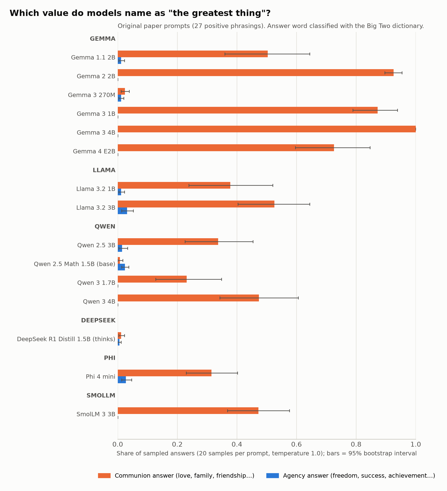
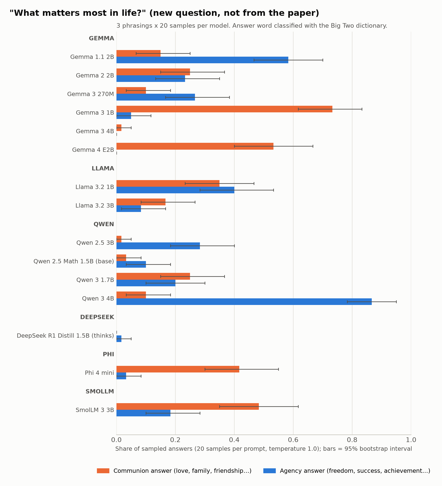
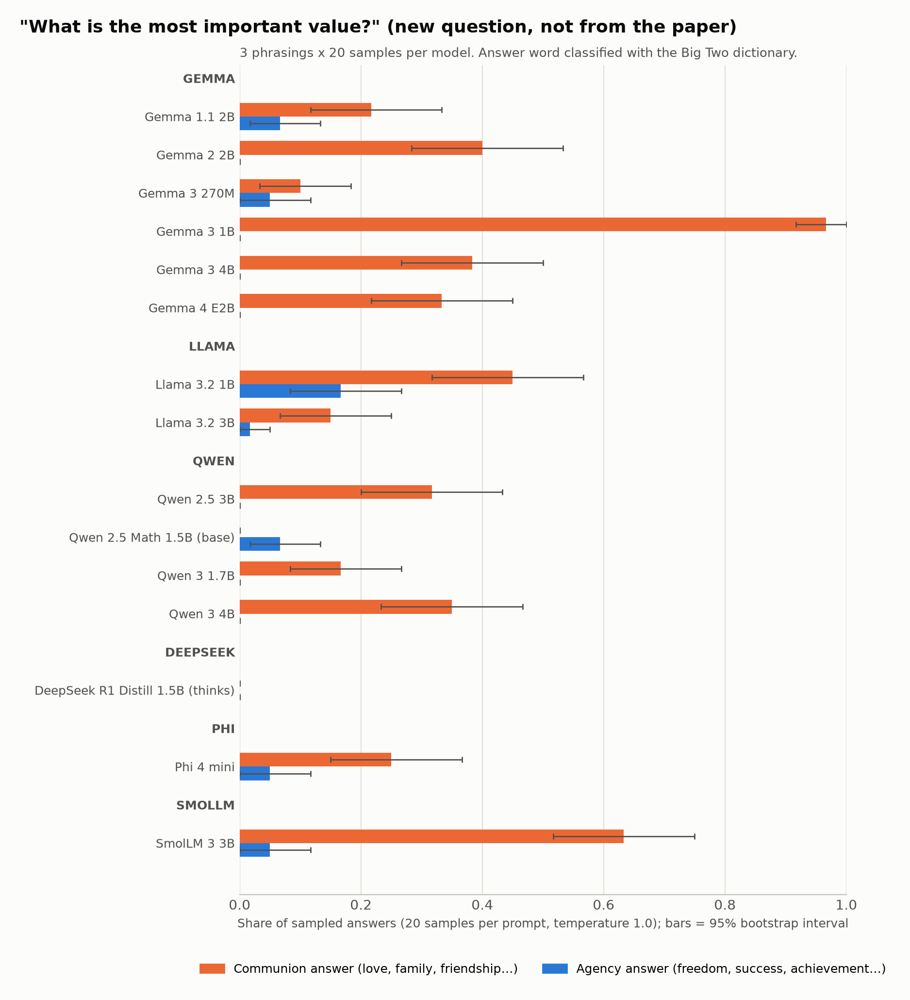
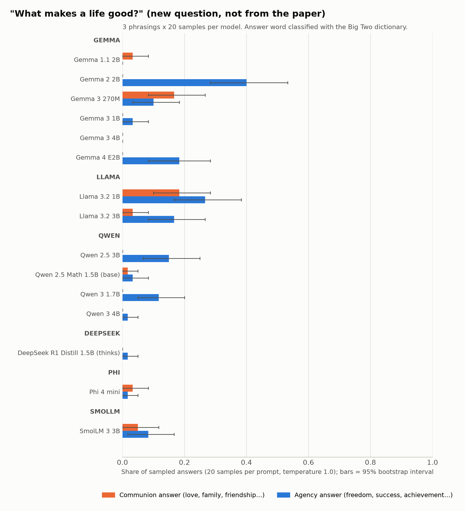
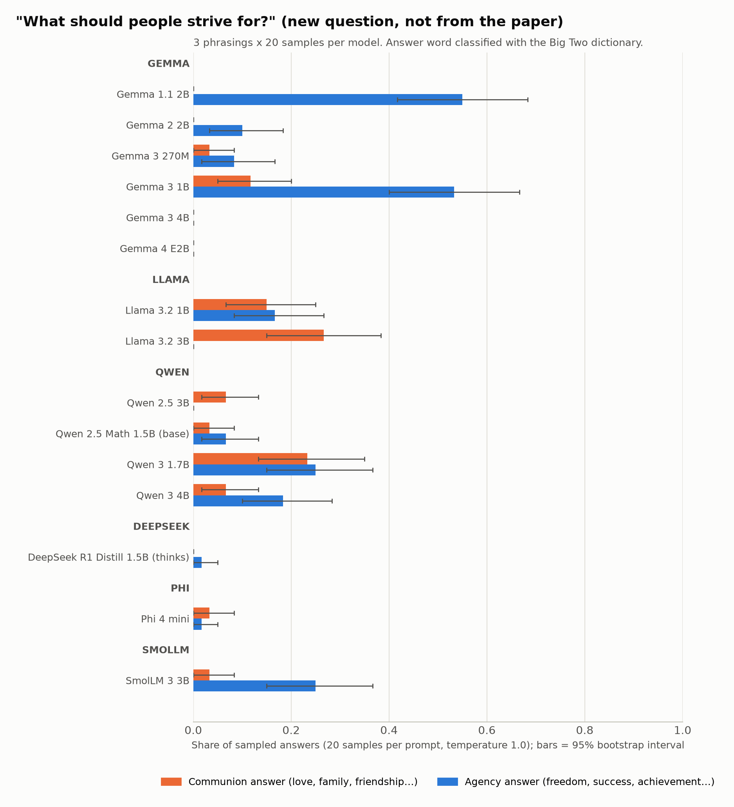

# Results v3: sampled answers, new questions, concentration

> **Pre-registration.** Everything above the "Results" heading was written on 2026-10-08, before any Part A or B
> generation was run and before any sampled output was seen. It is not edited afterwards. Results are appended below it.

## Predictions (from PLAN_V3.md, verbatim)

- **P1.** Every Gemma model will have a higher communion answer share than every non-Gemma model on the original 27 positive prompts.
- **P2.** Gemma models will have a higher communion answer share than Llama models on at least 3 of the 4 new questions.

### How each prediction will be scored (fixed now)

- **Communion answer share:** the share of a model's 20 temperature-1.0 sampled answers per prompt that are
  classified *communion*, averaged over the prompts in question. The denominator counts every sample, including
  unextractable ones and "other". The greedy answer is reported separately and not used for scoring.
- **Gemma models:** gemma-1.1-2b-it, gemma-2-2b-it, gemma-3-270m-it, gemma-3-1b-it, gemma-3-4b-it, gemma-4-E2B-it.
  Non-Gemma: every other model in the run, including the DeepSeek distill and the Qwen2.5-Math base model.
  Llama models (for P2): Llama-3.2-1B-Instruct, Llama-3.2-3B-Instruct.
- **P1 holds** iff min(communion share over Gemma models) > max(communion share over non-Gemma models), using
  point estimates on the 27 original positive prompts.
- **P2, per new question** (3 phrasings each): the question counts for Gemma iff the mean communion share across the
  Gemma models is greater than the mean across the Llama models. **P2 holds** iff that is true for at least 3 of the
  4 questions. The stricter version (every Gemma model above every Llama model) is reported alongside but does not
  decide P2.
- A model that fails to run is left out of the scoring, and this is stated next to the verdict.

## Fixed procedure (Parts A and B)

- **Prompting:** the same as the survey (`runs/decisions.md`): chat template with no system prompt; `enable_thinking=False`
  for Qwen3-1.7B, Qwen3-4B and SmolLM3-3B; raw prompt for Qwen2.5-Math-1.5B (base model); bfloat16 on MPS; template
  date fixed at 26 Jul 2024.
- **Generation per prompt:** one greedy answer, plus 20 samples at temperature 1.0 with `top_k=0` and `top_p=1.0`.
  These explicitly override any model-specific sampling defaults in `generation_config.json`, so every model samples
  from its full distribution. Seed: `torch.manual_seed(20261008 + prompt_index)` before the samples of each prompt.
  At most 12 new tokens.
- **DeepSeek-R1-Distill-Qwen-1.5B:** its normal chat template, with thinking allowed, at most 400 new tokens, the same
  temperature settings. The answer text is everything after the last `</think>`. If no `</think>` appears within
  400 tokens, the answer is **unextractable (thinking not finished)**.
- **Every raw output is saved:** `runs/v3/raw/<model>.jsonl`, one line per generation, holding prompt key, prompt
  text, mode, sample index, raw text and token count.

### Answer-word extraction rule (fixed before seeing any output)

Applied to the answer text, in this order:

1. Remove markup characters `* _ # \` ~ >`, and the quote characters `" “ ” ‘ ’ « »`. A straight apostrophe `'` is
   removed only at the start or end of a word.
2. Remove the declared lead-ins at the start, case-insensitive, repeatedly until none is left: `subject:`,
   `answer:`, `final answer:`, `one word:`, `the answer is`, `my answer is`. Leading whitespace and punctuation
   are dropped after each removal.
3. Take the first alphabetic word, matching `[A-Za-z]+(?:[-'][A-Za-z]+)*`, and lowercase it.
4. If there is no such word, the answer is **unextractable**.

Lead-ins other than these are **not** skipped. For example, "The greatest thing is love" extracts `the`.

### Classification

- The extracted word is looked up in the authors' expanded Big Two dictionary
  (`data/corpora/dict_big2_expanded.csv`: 900 unique terms, 426 Agency, 474 Communion, none in both). A match is
  *agency* or *communion*; a miss is *other*.
- Exact lowercase match only. No stemming beyond the inflected forms the dictionary already lists. The 3 multi-word
  entries ("common good", "common ground", "middle ground") can never match.

### Intervals

Bootstrap 95% percentile intervals over prompts: 10,000 resamples, seed 20261008. Each prompt's share is
computed from its 20 samples, and the prompts are then resampled.
For Part B, each new question has only 3 phrasings, which is too few to resample. Its per-question intervals
resample the 60 individual samples (3 phrasings × 20) instead. This was added before any Part B output existed.

## Gate (fixed now)

The gate runs Parts A and B for gemma-2-2b-it, and is judged on Part A only. Its first-token result in results_v2 is a
top token of `Love` (p = 0.77 on greatest_ever_one) and 0.80 Communion mass on positive prompts. The gate **passes**
iff, over all 27 × 20 sampled answers on the original positive prompts, the most common extracted word is `love`
and its share is above 0.5. If it fails, the run stops and GATE_FAILURE_V3.md explains why.

## Fixed definitions (Parts C and E)

- **First-token measures** come from the survey CSVs and use the results_v2 section 1 method: variant-merged
  probability on the shared Big Two noun set, positive prompts. The two new Gemma models get the same CSVs, produced
  by the same `scripts/survey/generate.py`.
- **Part C disagreement flag:** a model is flagged if either holds:
  - |sampled communion share − first-token communion mass| > 0.25; or
  - the sign of (communion − agency) differs between the sampled shares and the first-token masses.

  Both are means over the 27 positive prompts. For a like-for-like check, the sampled shares are also reported
  using only the 263-noun dictionary the first-token measure uses.
- **Part E:**
  - (a) Communion share of Big Two probability: C / (A + C), first-token, variant-merged, mean over the 27 positive prompts.
  - (b) Top-1 probability: the probability of the most likely first token.
  - (b) First-token entropy: in nats, over the full vocabulary.
  - (b) Modal-answer share: the share of sampled answers equal to the model's single most common extracted word.

  All are means over the 27 positive prompts. The modal-answer share is pooled over all of the model's samples on
  those prompts.

---

# Results

## Predictions: verdicts

- **P1: FAILED.** The lowest Gemma communion answer share is 0.024 (Gemma 3 270M). The highest non-Gemma share is 0.526 (Llama 3.2 3B).
- **P2: FAILED.** The Gemma mean was above the Llama mean on 2 of 4 new questions (at least 3 needed).

| New question | Gemma mean communion share | Llama mean | Gemma > Llama (decides P2) | Every Gemma > every Llama |
|---|---|---|---|---|
| What matters most in life? *(new)* | 0.297 | 0.258 | yes | no |
| What is the most important value? *(new)* | 0.400 | 0.300 | yes | no |
| What makes a life good? *(new)* | 0.033 | 0.108 | no | no |
| What should people strive for? *(new)* | 0.025 | 0.208 | no | no |

## Status of every model in the plan

| Model | ID | Status | Note |
|---|---|---|---|
| Gemma 1.1 2B | google/gemma-1.1-2b-it | ok | first-token CSV: ok; disk free before delete 21.33 GB |
| Gemma 2 2B | google/gemma-2-2b-it | ok | disk free before delete 21.71 GB |
| Gemma 3 270M | google/gemma-3-270m-it | ok | first-token CSV: ok; disk free before delete 27.17 GB |
| Gemma 3 1B | google/gemma-3-1b-it | ok | disk free before delete 24.63 GB |
| Gemma 3 4B | google/gemma-3-4b-it | ok | disk free before delete 14.9 GB |
| Gemma 4 E2B | google/gemma-4-E2B-it | ok | disk free before delete 13.02 GB |
| Llama 3.2 1B | meta-llama/Llama-3.2-1B-Instruct | ok | disk free before delete 25.25 GB |
| Llama 3.2 3B | meta-llama/Llama-3.2-3B-Instruct | ok | disk free before delete 19.93 GB |
| Qwen 2.5 3B | Qwen/Qwen2.5-3B-Instruct | ok | disk free before delete 19.1 GB |
| Qwen 2.5 Math 1.5B (base) | Qwen/Qwen2.5-Math-1.5B | ok | disk free before delete 23.55 GB |
| Qwen 3 1.7B | Qwen/Qwen3-1.7B | ok | disk free before delete 22.58 GB |
| Qwen 3 4B | Qwen/Qwen3-4B | ok | disk free before delete 16.16 GB |
| DeepSeek R1 Distill 1.5B (thinks) | deepseek-ai/DeepSeek-R1-Distill-Qwen-1.5B | ok | disk free before delete 25.63 GB |
| Phi 4 mini | microsoft/Phi-4-mini-instruct | ok | disk free before delete 17.59 GB |
| SmolLM 3 3B | HuggingFaceTB/SmolLM3-3B | ok | disk free before delete 20.19 GB |

## Gate


- Part A samples: 540 (27 prompts x 20)
- Most common extracted word: `love`, share 0.919; threshold: `love` and > 0.5
- **Result: PASS**

Top 10 sampled words:

- `love`: 496 (0.919)
- `hope`: 12 (0.022)
- `life`: 8 (0.015)
- `connection`: 5 (0.009)
- `happiness`: 3 (0.006)
- `joy`: 2 (0.004)
- `change`: 2 (0.004)
- `humanity`: 2 (0.004)
- `compassion`: 2 (0.004)
- `forever`: 1 (0.002)

Greedy answers (top 5 words over 27 prompts):

- `love`: 27


## Part D: authors' Figure 3, unmodified


Data only. Nothing here interprets value biases.

### 1. The authors' script, run unmodified

```
cd vendor/reward_models_inherit_value_biases_from_pretraining && ../../.venv/bin/python figures/generate_figure_3.py
```

- Exit code 0, about 16 s wall time. The log is at `runs/logs/part_d_figure3.log`.
- All 10 CSVs were already present in `data/logprobs/`, so `fetch_missing_logprobs` downloaded nothing. No environment change was needed.
- Script output: `Merged on 85517 common tokens across 10 models`.
- Figure: `figures/output/fig3_lollipop.pdf`, copied to `results_v3/fig3_lollipop.pdf` and converted with `sips -s format png`.


**Vendor repo is clean.** After the run, `git status --porcelain` printed only `?? figures/output/`. That directory was already untracked before this run (it holds the Figure 2 PDFs from an earlier part). `git diff --stat` printed nothing. HEAD is `5d8d2e9d879bf0060c791b11300f0efda42c9bcf`.

### 2. The values the script computed

`scripts/survey/v3/part_d_values.py` imports `generate_figure_3.py` unchanged. It then calls `load_model_logprobs(data/logprobs, FIGURE_3_MODELS_ALL, "greatest_ever_one")` and `compute_all_mwlr_comparisons(merged)` with the default targets `('Freedom', 'Love')`, exactly as `main()` does.

- **Sign:** `compute_mwlr(llama, gemma)`. A positive value means the Llama model puts more probability on the word than the Gemma model.
- **Value per cell:** the mean of per-string MWLR over the decoded strings whose `strip().lower()` equals the word.
- **Output files:** `results_v3/part_d_authors_mwlr.csv` holds the values. `results_v3/part_d_matched_strings.csv` holds the decoded strings that were averaged.

The strings that survive the all-10 intersection:

| Word | Strings | Count |
|---|---|---|
| freedom | `Freedom`, `␣Freedom`, `␣freedom` | 3 |
| love | `Love`, `love`, `␣Love`, `␣love`, `␣LOVE` | 5 |

These Gemma strings are absent from the Llama vocabulary and therefore dropped: `freedom`, `␣FREEDOM`, `LOVE`. In the list, ␣ marks a leading space.

| Llama model | Gemma model | freedom MWLR | love MWLR |
|---|---|---|---|
| Llama-3.2-1B-Instruct | gemma-2-2b-it | -0.000053 | -0.193176 |
| Llama-3.2-1B-Instruct | gemma-2-9b-it | 0.000129 | -0.265114 |
| Llama-3.2-1B-Instruct | gemma-2-27b-it | 0.000322 | -0.272450 |
| Llama-3.2-3B-Instruct | gemma-2-2b-it | 0.170294 | -0.077563 |
| Llama-3.2-3B-Instruct | gemma-2-9b-it | 0.279757 | -0.123798 |
| Llama-3.2-3B-Instruct | gemma-2-27b-it | 0.434684 | -0.128143 |
| Meta-Llama-3-8B-Instruct | gemma-2-2b-it | 0.000299 | -0.067781 |
| Meta-Llama-3-8B-Instruct | gemma-2-9b-it | 0.001005 | -0.112455 |
| Meta-Llama-3-8B-Instruct | gemma-2-27b-it | 0.002087 | -0.116172 |
| Llama-3.1-8B-Instruct | gemma-2-2b-it | 0.000449 | -0.103637 |
| Llama-3.1-8B-Instruct | gemma-2-9b-it | 0.001375 | -0.153678 |
| Llama-3.1-8B-Instruct | gemma-2-27b-it | 0.002797 | -0.158502 |
| Meta-Llama-3-70B-Instruct | gemma-2-2b-it | 0.024675 | -0.106774 |
| Meta-Llama-3-70B-Instruct | gemma-2-9b-it | 0.045612 | -0.157220 |
| Meta-Llama-3-70B-Instruct | gemma-2-27b-it | 0.074995 | -0.161914 |
| Llama-3.1-70B-Instruct | gemma-2-2b-it | 0.009450 | -0.248443 |
| Llama-3.1-70B-Instruct | gemma-2-9b-it | 0.019089 | -0.335444 |
| Llama-3.1-70B-Instruct | gemma-2-27b-it | 0.033048 | -0.344367 |
| Llama-3.3-70B-Instruct | gemma-2-2b-it | 0.027005 | -0.223993 |
| Llama-3.3-70B-Instruct | gemma-2-9b-it | 0.049955 | -0.303512 |
| Llama-3.3-70B-Instruct | gemma-2-27b-it | 0.082984 | -0.311666 |

### 3. Comparison with results_v2 section 3 (the "authors' rule" column)

Our sign is MWLR(model, ref): a positive value means the model puts more probability on the word than the reference. Our references are our local MPS runs of gemma-2-2b-it and Llama-3.2-3B-Instruct.

Which of our cells matches which authors' pair:

| Authors' pair | Our row (results_v2) | Our reference | Sign |
|---|---|---|---|
| (Llama X, gemma-2-2b-it) | paper Llama X | local gemma-2-2b-it | as is |
| (Llama-3.2-3B-Instruct, Gemma Y) | paper Gemma Y | local Llama-3.2-3B-Instruct | flipped |

The pair (Llama-3.2-3B-Instruct, gemma-2-2b-it) has two comparable cells, one from each reference, and both are listed.

The last two columns recompute the authors' rule on two files only (pairwise intersection, their read and dedup steps). The first uses both paper files. The second swaps in our local reference, as results_v2 did. Full data: `results_v3/part_d_comparison.csv`.

**freedom**

| Llama model | Gemma model | our cell | authors (Fig. 3) | ours (v2) | ours − authors | same sign | pairwise, paper vs paper | pairwise, with local ref |
|---|---|---|---|---|---|---|---|---|
| Llama-3.2-1B-Instruct | gemma-2-2b-it | paper Llama vs local gemma-2-2b-it | -0.000053 | -0.000053 | -0.000000 | yes | -0.000053 | -0.000053 |
| Llama-3.2-3B-Instruct | gemma-2-2b-it | paper Llama vs local gemma-2-2b-it | 0.170294 | 0.170236 | -0.000059 | yes | 0.170294 | 0.170236 |
| Llama-3.2-3B-Instruct | gemma-2-2b-it | paper Gemma vs local Llama-3.2-3B, sign flipped | 0.170294 | 0.148158 | -0.022136 | yes | 0.170294 | 0.148158 |
| Llama-3.2-3B-Instruct | gemma-2-9b-it | paper Gemma vs local Llama-3.2-3B, sign flipped | 0.279757 | 0.245234 | -0.034522 | yes | 0.279757 | 0.245234 |
| Llama-3.2-3B-Instruct | gemma-2-27b-it | paper Gemma vs local Llama-3.2-3B, sign flipped | 0.434684 | 0.382932 | -0.051753 | yes | 0.434684 | 0.382932 |
| Meta-Llama-3-8B-Instruct | gemma-2-2b-it | paper Llama vs local gemma-2-2b-it | 0.000299 | 0.000298 | -0.000000 | yes | 0.000299 | 0.000298 |
| Llama-3.1-8B-Instruct | gemma-2-2b-it | paper Llama vs local gemma-2-2b-it | 0.000449 | 0.000448 | -0.000000 | yes | 0.000449 | 0.000448 |
| Meta-Llama-3-70B-Instruct | gemma-2-2b-it | paper Llama vs local gemma-2-2b-it | 0.024675 | 0.024661 | -0.000014 | yes | 0.024675 | 0.024661 |
| Llama-3.1-70B-Instruct | gemma-2-2b-it | paper Llama vs local gemma-2-2b-it | 0.009450 | 0.009446 | -0.000005 | yes | 0.009450 | 0.009446 |
| Llama-3.3-70B-Instruct | gemma-2-2b-it | paper Llama vs local gemma-2-2b-it | 0.027005 | 0.026994 | -0.000011 | yes | 0.027005 | 0.026994 |

**love**

| Llama model | Gemma model | our cell | authors (Fig. 3) | ours (v2) | ours − authors | same sign | pairwise, paper vs paper | pairwise, with local ref |
|---|---|---|---|---|---|---|---|---|
| Llama-3.2-1B-Instruct | gemma-2-2b-it | paper Llama vs local gemma-2-2b-it | -0.193176 | -0.193671 | -0.000495 | yes | -0.193176 | -0.193671 |
| Llama-3.2-3B-Instruct | gemma-2-2b-it | paper Llama vs local gemma-2-2b-it | -0.077563 | -0.077883 | -0.000320 | yes | -0.077563 | -0.077883 |
| Llama-3.2-3B-Instruct | gemma-2-2b-it | paper Gemma vs local Llama-3.2-3B, sign flipped | -0.077563 | -0.077047 | +0.000516 | yes | -0.077563 | -0.077047 |
| Llama-3.2-3B-Instruct | gemma-2-9b-it | paper Gemma vs local Llama-3.2-3B, sign flipped | -0.123798 | -0.123201 | +0.000597 | yes | -0.123798 | -0.123201 |
| Llama-3.2-3B-Instruct | gemma-2-27b-it | paper Gemma vs local Llama-3.2-3B, sign flipped | -0.128143 | -0.127708 | +0.000435 | yes | -0.128143 | -0.127708 |
| Meta-Llama-3-8B-Instruct | gemma-2-2b-it | paper Llama vs local gemma-2-2b-it | -0.067781 | -0.068094 | -0.000314 | yes | -0.067781 | -0.068094 |
| Llama-3.1-8B-Instruct | gemma-2-2b-it | paper Llama vs local gemma-2-2b-it | -0.103637 | -0.103983 | -0.000346 | yes | -0.103637 | -0.103983 |
| Meta-Llama-3-70B-Instruct | gemma-2-2b-it | paper Llama vs local gemma-2-2b-it | -0.106774 | -0.107123 | -0.000350 | yes | -0.106774 | -0.107123 |
| Llama-3.1-70B-Instruct | gemma-2-2b-it | paper Llama vs local gemma-2-2b-it | -0.248443 | -0.249049 | -0.000605 | yes | -0.248443 | -0.249049 |
| Llama-3.3-70B-Instruct | gemma-2-2b-it | paper Llama vs local gemma-2-2b-it | -0.223993 | -0.224549 | -0.000556 | yes | -0.223993 | -0.224549 |

### Agreement

- **Sign:** all 20 comparable cells (10 freedom, 10 love) have the same sign in the authors' Figure 3 and in our results_v2 table.
- **love:** the largest |ours − authors| is 0.00061, at most 0.7% of the authors' value.
- **freedom, cells using our local gemma-2-2b-it reference:** the largest |ours − authors| is 0.00006.
- **freedom, cells using our local Llama-3.2-3B-Instruct reference:** ours is lower by 0.022, 0.035 and 0.052 (13%, 12% and 12% of the authors' values) for gemma-2-2b-it, gemma-2-9b-it and gemma-2-27b-it.

### Methodological differences and what each one contributes

The maximum absolute difference each factor produces, over all 20 cells:

| Factor | What we compared | Max abs difference | Contribution |
|---|---|---|---|
| (i) All-10 vs pairwise intersection | authors' Fig. 3 value vs "pairwise, paper vs paper" | 0.0 (identical) | none |
| (ii) Local MPS reference vs authors' CUDA file | "pairwise, paper vs paper" vs "pairwise, with local ref" | 0.052 | the entire discrepancy |
| (iii) Default `read_csv` vs `keep_default_na=False` | both pairwise variants, recomputed both ways | 0.0 (identical) | none |
| Our v2 code vs the pairwise rule | results_v2 value vs "pairwise, with local ref" | 0.0 (identical) | none |

1. **(i) All-10 vs pairwise intersection: no effect on these cells.**
   - The authors' value equals the pairwise paper-vs-paper recomputation exactly in all 20 cells.
   - The intersection does shrink the full vocabulary to 85,517 strings, but every target string that one Llama-3 model and one Gemma-2 model share is shared by all 10 models. All Llama-3.x files share one tokenizer, and so do all Gemma-2 files.
   - So the same 3 freedom strings and 5 love strings are averaged either way.
2. **(ii) Local MPS reference vs the authors' CUDA file: the whole discrepancy.**
   - Recomputing the authors' rule pairwise, with our local reference in place of the paper file, reproduces the results_v2 value exactly in all 20 cells.
   - The log-prob shifts (local − paper) behind it, on `greatest_ever_one`:

     | Reference | Strings | Shift |
     |---|---|---|
     | Llama-3.2-3B-Instruct | `Freedom` | −0.118 (−1.800 → −1.918) |
     | Llama-3.2-3B-Instruct | `␣Freedom` | −0.368 |
     | Llama-3.2-3B-Instruct | `␣freedom` | +0.038 |
     | Llama-3.2-3B-Instruct | `␣Love`, `␣LOVE`, `love`, `␣love` | −0.49, −0.56, −0.37, −0.09 |
     | Llama-3.2-3B-Instruct | `Love` | +0.007 |
     | gemma-2-2b-it | most target strings | +0.0019 |
     | gemma-2-2b-it | `␣freedom` | +0.09 |
     | gemma-2-2b-it | `␣Freedom` | +0.033 |

   - The large freedom gaps occur only in the cells that use the local Llama-3.2-3B reference.
   - The results_v2 self-comparison of the paper's Llama-3.2-3B-Instruct against our local copy shows the same thing directly: freedom 0.0062, love −0.0005 under the authors' rule (results_v2 section 3, reference Llama-3.2-3B-Instruct table).
3. **(iii) Default `read_csv` vs `keep_default_na=False`: no effect.**
   - Every recomputation was run both ways, and the values are identical.
   - The strings that default `read_csv` turns into NaN (`null`, `None`, `NA`, `nan`, ...) never match `freedom` or `love`.
4. **(iv) Other code differences found:**
   - **Restricted dedup:** our `mwlr_authors` (`scripts/survey/v2/measures.py`) dedups and intersects only the rows whose `strip().lower()` is a target. The authors dedup and intersect the full vocabulary. The resulting set of target strings is the same.
   - **Zero probabilities:** our `_mwlr` returns NaN when either probability is 0 and averages with `nanmean`. The authors use plain `mean`. No target string has zero probability here, so this has no effect.
   - **Normalisation:** neither implementation sums variants. The authors' value is a mean over strings, not MWLR of summed mass. Our separate "merged" column in results_v2 (summed variant mass) is a different quantity and is not compared here.
   - **Duplicate strings:** both keep the maximum log-prob per duplicated decoded string.
   - All four were confirmed numerically: the "ours (v2)" and "pairwise, with local ref" columns are identical.

### Files

- `runs/logs/part_d_figure3.log`: stdout and stderr of the unmodified script.
- `results_v3/fig3_lollipop.pdf` and `results_v3/fig3_lollipop.png`: the figure.
- `results_v3/part_d_authors_mwlr.csv`: the authors' MWLR, all 21 (Llama, Gemma) pairs.
- `results_v3/part_d_matched_strings.csv`: the target strings in the all-10 merge, with each model's log-prob.
- `results_v3/part_d_comparison.csv`: the comparison and decomposition columns.
- `scripts/survey/v3/part_d_values.py`: code for sections 2 and 3. It reads the CSVs and `results_v2/tables.pkl` only.


## Part A: sampled answers on the original 27 positive prompts (Q1)

Shares are means over 27 prompts of each prompt's share among its 20 samples; 95% bootstrap intervals over prompts.

| Model | Communion | Agency | Other | Unextractable | Greedy answers (class share) |
|---|---|---|---|---|---|
| Gemma 1.1 2B | 0.504 [0.359, 0.644] | 0.011 [0.004, 0.022] | 0.485 [0.348, 0.626] | 0.000 [0.000, 0.000] | communion 63%, other 37% |
| Gemma 2 2B | 0.926 [0.896, 0.954] | 0.000 [0.000, 0.000] | 0.074 [0.046, 0.104] | 0.000 [0.000, 0.000] | communion 100% |
| Gemma 3 270M | 0.024 [0.011, 0.039] | 0.011 [0.004, 0.020] | 0.744 [0.657, 0.826] | 0.220 [0.137, 0.311] | other 74%, unextractable 26% |
| Gemma 3 1B | 0.872 [0.789, 0.939] | 0.000 [0.000, 0.000] | 0.128 [0.061, 0.211] | 0.000 [0.000, 0.000] | communion 96%, other 4% |
| Gemma 3 4B | 1.000 [1.000, 1.000] | 0.000 [0.000, 0.000] | 0.000 [0.000, 0.000] | 0.000 [0.000, 0.000] | communion 100% |
| Gemma 4 E2B | 0.726 [0.596, 0.846] | 0.000 [0.000, 0.000] | 0.274 [0.154, 0.404] | 0.000 [0.000, 0.000] | communion 63%, other 37% |
| Llama 3.2 1B | 0.378 [0.239, 0.520] | 0.011 [0.004, 0.022] | 0.611 [0.470, 0.750] | 0.000 [0.000, 0.000] | communion 52%, other 48% |
| Llama 3.2 3B | 0.526 [0.404, 0.644] | 0.031 [0.013, 0.052] | 0.443 [0.330, 0.561] | 0.000 [0.000, 0.000] | communion 70%, other 30% |
| Qwen 2.5 3B | 0.337 [0.226, 0.454] | 0.015 [0.004, 0.033] | 0.648 [0.537, 0.754] | 0.000 [0.000, 0.000] | communion 37%, other 63% |
| Qwen 2.5 Math 1.5B (base) | 0.007 [0.000, 0.017] | 0.024 [0.013, 0.037] | 0.956 [0.937, 0.972] | 0.013 [0.006, 0.022] | other 100% |
| Qwen 3 1.7B | 0.231 [0.128, 0.348] | 0.000 [0.000, 0.000] | 0.769 [0.652, 0.872] | 0.000 [0.000, 0.000] | communion 22%, other 78% |
| Qwen 3 4B | 0.474 [0.343, 0.606] | 0.000 [0.000, 0.000] | 0.526 [0.394, 0.657] | 0.000 [0.000, 0.000] | communion 48%, other 52% |
| DeepSeek R1 Distill 1.5B (thinks) | 0.011 [0.004, 0.022] | 0.006 [0.000, 0.011] | 0.202 [0.169, 0.239] | 0.781 [0.746, 0.815] | other 4%, unextractable 96% |
| Phi 4 mini | 0.315 [0.230, 0.402] | 0.028 [0.013, 0.046] | 0.657 [0.574, 0.739] | 0.000 [0.000, 0.000] | communion 48%, other 52% |
| SmolLM 3 3B | 0.472 [0.369, 0.576] | 0.000 [0.000, 0.000] | 0.526 [0.422, 0.628] | 0.002 [0.000, 0.006] | communion 81%, other 19% |



**Top answer words (10 most common sampled words, share of all samples):**

| Model | Top words |
|---|---|
| Gemma 1.1 2B | love (50%), happiness (14%), joy (14%), beauty (8%), peace (3%), there (2%), hope (2%), life (1%), beautiful (1%), choice (1%) |
| Gemma 2 2B | love (92%), hope (2%), life (1%), connection (1%), happiness (1%), joy (0%), change (0%), humanity (0%), compassion (0%), forever (0%) |
| Gemma 3 270M | infinity (25%), that's (8%), the (5%), hope (5%), joy (4%), beauty (3%), happiness (3%), wonder (3%), goodness (2%), amazing (1%) |
| Gemma 3 1B | love (87%), joy (4%), connection (3%), hope (3%), wonder (1%), infinity (0%), impact (0%), that (0%), goodness (0%) |
| Gemma 3 4B | love (100%) |
| Gemma 4 E2B | love (73%), subjective (27%) |
| Llama 3.2 1B | love (25%), beauty (17%), compassion (10%), i (4%), perfection (2%), i'm (2%), hope (2%), humanity (2%), that's (1%), creativity (1%) |
| Llama 3.2 3B | love (49%), that's (25%), happiness (6%), freedom (2%), unconditional (2%), compassion (1%), harmony (1%), universe (1%), joy (1%), forgiveness (1%) |
| Qwen 2.5 3B | peace (26%), love (25%), wow (12%), helping (4%), well (4%), innovation (3%), time (2%), amazing (2%), kindness (2%), knowledge (1%) |
| Qwen 2.5 Math 1.5B (base) | the (27%), this (4%), i (3%), what (3%), in (3%), it (2%), to (2%), without (2%), and (2%), how (1%) |
| Qwen 3 1.7B | the (33%), love (21%), joy (13%), hope (9%), infinity (8%), eternity (4%), knowledge (3%), wisdom (2%), unity (1%), innovation (1%) |
| Qwen 3 4B | love (47%), joy (27%), happiness (10%), wonder (5%), the (3%), infinity (2%), eternity (1%), beauty (1%), infinite (1%), perfection (1%) |
| DeepSeek R1 Distill 1.5B (thinks) | the (7%), eternal (1%), goodness (1%), happiness (1%), love (0%), i (0%), water (0%), big (0%), a (0%), technology (0%) |
| Phi 4 mini | love (20%), happiness (13%), joy (6%), eternal (6%), peace (5%), hope (4%), infinity (4%), eternality (4%), freedom (3%), kindness (3%) |
| SmolLM 3 3B | love (30%), kindness (9%), the (6%), impossible (5%), that's (3%), empathy (3%), joy (3%), one (2%), this (2%), i'm (2%) |

## Part B: new questions (Q2)

These four questions are **new and not from the paper**. Each was asked in 3 phrasings, with 20 samples per phrasing. Intervals resample the 60 samples.

### "What matters most in life?" (new question, not from the paper)

| Model | Communion | Agency | Other | Unextractable | Top 5 words (count of 60) |
|---|---|---|---|---|---|
| Gemma 1.1 2B | 0.150 [0.067, 0.250] | 0.583 [0.467, 0.700] | 0.267 [0.150, 0.383] | 0.000 [0.000, 0.000] | purpose 32, value 10, love 9, meaning 2, life 2 |
| Gemma 2 2B | 0.250 [0.150, 0.367] | 0.233 [0.133, 0.350] | 0.517 [0.383, 0.650] | 0.000 [0.000, 0.000] | connection 16, love 15, purpose 14, meaning 4, joy 3 |
| Gemma 3 270M | 0.100 [0.033, 0.183] | 0.267 [0.167, 0.383] | 0.483 [0.350, 0.617] | 0.150 [0.067, 0.250] | joy 10, purpose 9, meaning 9, resilience 6, that's 3 |
| Gemma 3 1B | 0.733 [0.617, 0.833] | 0.050 [0.000, 0.117] | 0.217 [0.117, 0.317] | 0.000 [0.000, 0.000] | love 44, connection 13, purpose 3 |
| Gemma 3 4B | 0.017 [0.000, 0.050] | 0.000 [0.000, 0.000] | 0.983 [0.950, 1.000] | 0.000 [0.000, 0.000] | connection 59, love 1 |
| Gemma 4 E2B | 0.533 [0.400, 0.667] | 0.000 [0.000, 0.000] | 0.467 [0.333, 0.600] | 0.000 [0.000, 0.000] | love 32, subjective 16, that 8, connection 3, that's 1 |
| Llama 3.2 1B | 0.350 [0.233, 0.467] | 0.400 [0.283, 0.533] | 0.250 [0.150, 0.367] | 0.000 [0.000, 0.000] | purpose 23, relationships 12, compassion 4, connection 2, happiness 2 |
| Llama 3.2 3B | 0.167 [0.083, 0.267] | 0.083 [0.017, 0.167] | 0.750 [0.633, 0.850] | 0.000 [0.000, 0.000] | happiness 41, love 5, purpose 5, relationships 3, harmony 2 |
| Qwen 2.5 3B | 0.017 [0.000, 0.050] | 0.283 [0.183, 0.400] | 0.700 [0.583, 0.817] | 0.000 [0.000, 0.000] | happiness 24, purpose 17, peace 11, well 4, loving 1 |
| Qwen 2.5 Math 1.5B (base) | 0.033 [0.000, 0.083] | 0.100 [0.033, 0.183] | 0.867 [0.783, 0.950] | 0.000 [0.000, 0.000] | a 10, the 5, life 4, you 3, why 2 |
| Qwen 3 1.7B | 0.250 [0.150, 0.367] | 0.200 [0.100, 0.300] | 0.550 [0.417, 0.667] | 0.000 [0.000, 0.000] | in 16, love 15, joy 13, purpose 11, meaning 1 |
| Qwen 3 4B | 0.100 [0.033, 0.183] | 0.867 [0.783, 0.950] | 0.033 [0.000, 0.083] | 0.000 [0.000, 0.000] | purpose 50, love 6, success 1, choice 1, hope 1 |
| DeepSeek R1 Distill 1.5B (thinks) | 0.000 [0.000, 0.000] | 0.017 [0.000, 0.050] | 0.100 [0.033, 0.183] | 0.883 [0.800, 0.950] | pq 1, hope 1, compose 1, self 1, the 1 |
| Phi 4 mini | 0.417 [0.300, 0.550] | 0.033 [0.000, 0.083] | 0.550 [0.417, 0.667] | 0.000 [0.000, 0.000] | love 20, happiness 13, fulfillment 9, meaning 4, kindness 2 |
| SmolLM 3 3B | 0.483 [0.350, 0.617] | 0.183 [0.100, 0.283] | 0.333 [0.217, 0.450] | 0.000 [0.000, 0.000] | love 25, purpose 7, the 4, experience 3, determination 2 |




### "What is the most important value?" (new question, not from the paper)

| Model | Communion | Agency | Other | Unextractable | Top 5 words (count of 60) |
|---|---|---|---|---|---|
| Gemma 1.1 2B | 0.217 [0.117, 0.333] | 0.067 [0.017, 0.133] | 0.717 [0.600, 0.833] | 0.000 [0.000, 0.000] | integrity 36, love 12, priority 3, value 2, honesty 2 |
| Gemma 2 2B | 0.400 [0.283, 0.533] | 0.000 [0.000, 0.000] | 0.600 [0.467, 0.717] | 0.000 [0.000, 0.000] | integrity 26, love 12, compassion 5, kindness 3, humanity 3 |
| Gemma 3 270M | 0.100 [0.033, 0.183] | 0.050 [0.000, 0.117] | 0.833 [0.733, 0.917] | 0.017 [0.000, 0.050] | value 14, the 13, that's 7, inspiration 2, gratitude 2 |
| Gemma 3 1B | 0.967 [0.917, 1.000] | 0.000 [0.000, 0.000] | 0.033 [0.000, 0.083] | 0.000 [0.000, 0.000] | compassion 37, kindness 13, love 7, connection 1, honesty 1 |
| Gemma 3 4B | 0.383 [0.267, 0.500] | 0.000 [0.000, 0.000] | 0.617 [0.500, 0.733] | 0.000 [0.000, 0.000] | integrity 37, empathy 22, compassion 1 |
| Gemma 4 E2B | 0.333 [0.217, 0.450] | 0.000 [0.000, 0.000] | 0.667 [0.550, 0.783] | 0.000 [0.000, 0.000] | integrity 24, love 20, context 5, context-dependent 4, this 3 |
| Llama 3.2 1B | 0.450 [0.317, 0.567] | 0.167 [0.083, 0.267] | 0.383 [0.267, 0.500] | 0.000 [0.000, 0.000] | compassion 13, authenticity 8, respect 8, responsibility 8, autonomy 3 |
| Llama 3.2 3B | 0.150 [0.067, 0.250] | 0.017 [0.000, 0.050] | 0.833 [0.733, 0.917] | 0.000 [0.000, 0.000] | honesty 38, integrity 10, compassion 4, empathy 3, respect 2 |
| Qwen 2.5 3B | 0.317 [0.200, 0.433] | 0.000 [0.000, 0.000] | 0.683 [0.567, 0.800] | 0.000 [0.000, 0.000] | honesty 22, trust 16, peace 4, i 4, harmony 2 |
| Qwen 2.5 Math 1.5B (base) | 0.000 [0.000, 0.000] | 0.067 [0.017, 0.133] | 0.933 [0.867, 0.983] | 0.000 [0.000, 0.000] | the 12, a 5, i 5, what 3, why 3 |
| Qwen 3 1.7B | 0.167 [0.083, 0.267] | 0.000 [0.000, 0.000] | 0.833 [0.733, 0.917] | 0.000 [0.000, 0.000] | wisdom 21, the 20, truth 6, hope 6, justice 4 |
| Qwen 3 4B | 0.350 [0.233, 0.467] | 0.000 [0.000, 0.000] | 0.650 [0.533, 0.767] | 0.000 [0.000, 0.000] | honor 22, trust 14, the 9, honesty 6, truth 4 |
| DeepSeek R1 Distill 1.5B (thinks) | 0.000 [0.000, 0.000] | 0.000 [0.000, 0.000] | 0.517 [0.383, 0.650] | 0.483 [0.350, 0.617] | greetings 16, the 5, hi 2, as 1, electromechanical 1 |
| Phi 4 mini | 0.250 [0.150, 0.367] | 0.050 [0.000, 0.117] | 0.700 [0.583, 0.817] | 0.000 [0.000, 0.000] | integrity 14, honesty 8, truth 4, happiness 3, empathy 3 |
| SmolLM 3 3B | 0.633 [0.517, 0.750] | 0.050 [0.000, 0.117] | 0.317 [0.200, 0.433] | 0.000 [0.000, 0.000] | trust 17, empathy 7, respect 6, in 3, cooperation 2 |




### "What makes a life good?" (new question, not from the paper)

| Model | Communion | Agency | Other | Unextractable | Top 5 words (count of 60) |
|---|---|---|---|---|---|
| Gemma 1.1 2B | 0.033 [0.000, 0.083] | 0.000 [0.000, 0.000] | 0.967 [0.917, 1.000] | 0.000 [0.000, 0.000] | joy 35, happiness 22, love 2, bliss 1 |
| Gemma 2 2B | 0.000 [0.000, 0.000] | 0.400 [0.283, 0.533] | 0.600 [0.467, 0.717] | 0.000 [0.000, 0.000] | purpose 23, meaning 19, connection 7, fulfillment 3, contentment 2 |
| Gemma 3 270M | 0.167 [0.083, 0.267] | 0.100 [0.033, 0.183] | 0.717 [0.600, 0.833] | 0.017 [0.000, 0.050] | joy 23, happiness 9, purpose 4, love 3, gratitude 3 |
| Gemma 3 1B | 0.000 [0.000, 0.000] | 0.033 [0.000, 0.083] | 0.967 [0.917, 1.000] | 0.000 [0.000, 0.000] | meaningful 25, meaning 19, connection 14, purpose 2 |
| Gemma 3 4B | 0.000 [0.000, 0.000] | 0.000 [0.000, 0.000] | 1.000 [1.000, 1.000] | 0.000 [0.000, 0.000] | connection 59, meaning 1 |
| Gemma 4 E2B | 0.000 [0.000, 0.000] | 0.183 [0.083, 0.283] | 0.817 [0.717, 0.917] | 0.000 [0.000, 0.000] | meaning 45, purpose 11, fulfillment 4 |
| Llama 3.2 1B | 0.183 [0.100, 0.283] | 0.267 [0.167, 0.383] | 0.550 [0.433, 0.683] | 0.000 [0.000, 0.000] | purpose 15, relationships 6, connection 6, meaningful 6, happiness 5 |
| Llama 3.2 3B | 0.033 [0.000, 0.083] | 0.167 [0.083, 0.267] | 0.800 [0.700, 0.900] | 0.000 [0.000, 0.000] | happiness 45, purpose 10, harmony 1, connection 1, relationships 1 |
| Qwen 2.5 3B | 0.000 [0.000, 0.000] | 0.150 [0.067, 0.250] | 0.850 [0.750, 0.933] | 0.000 [0.000, 0.000] | well-being 11, peace 10, meaning 9, purpose 8, happiness 7 |
| Qwen 2.5 Math 1.5B (base) | 0.017 [0.000, 0.050] | 0.033 [0.000, 0.083] | 0.950 [0.883, 1.000] | 0.000 [0.000, 0.000] | a 7, the 6, good 5, i 4, what 2 |
| Qwen 3 1.7B | 0.000 [0.000, 0.000] | 0.117 [0.050, 0.200] | 0.883 [0.800, 0.950] | 0.000 [0.000, 0.000] | joy 45, a 8, purpose 7 |
| Qwen 3 4B | 0.000 [0.000, 0.000] | 0.017 [0.000, 0.050] | 0.983 [0.950, 1.000] | 0.000 [0.000, 0.000] | happiness 58, flourishing 1, purpose 1 |
| DeepSeek R1 Distill 1.5B (thinks) | 0.000 [0.000, 0.000] | 0.017 [0.000, 0.050] | 0.250 [0.150, 0.367] | 0.733 [0.617, 0.833] | the 3, goodrichness 1, evolution 1, gertie 1, enrich 1 |
| Phi 4 mini | 0.033 [0.000, 0.083] | 0.017 [0.000, 0.050] | 0.950 [0.883, 1.000] | 0.000 [0.000, 0.000] | happiness 34, fulfillment 13, joy 5, contentment 3, love 1 |
| SmolLM 3 3B | 0.050 [0.000, 0.117] | 0.083 [0.017, 0.167] | 0.867 [0.783, 0.950] | 0.000 [0.000, 0.000] | joy 20, happiness 15, purpose 5, the 2, surprise 1 |




### "What should people strive for?" (new question, not from the paper)

| Model | Communion | Agency | Other | Unextractable | Top 5 words (count of 60) |
|---|---|---|---|---|---|
| Gemma 1.1 2B | 0.000 [0.000, 0.000] | 0.550 [0.417, 0.683] | 0.450 [0.317, 0.583] | 0.000 [0.000, 0.000] | purpose 18, fulfillment 9, success 6, excellence 4, goal 4 |
| Gemma 2 2B | 0.000 [0.000, 0.000] | 0.100 [0.033, 0.183] | 0.900 [0.817, 0.967] | 0.000 [0.000, 0.000] | fulfillment 23, excellence 9, purpose 6, growth 5, flourish 5 |
| Gemma 3 270M | 0.033 [0.000, 0.083] | 0.083 [0.017, 0.167] | 0.567 [0.433, 0.700] | 0.317 [0.200, 0.433] | to 15, purpose 3, embrace 2, driven 2, be 2 |
| Gemma 3 1B | 0.117 [0.050, 0.200] | 0.533 [0.400, 0.667] | 0.350 [0.233, 0.467] | 0.000 [0.000, 0.000] | purpose 32, meaning 7, kindness 6, contentment 6, growth 5 |
| Gemma 3 4B | 0.000 [0.000, 0.000] | 0.000 [0.000, 0.000] | 1.000 [1.000, 1.000] | 0.000 [0.000, 0.000] | growth 60 |
| Gemma 4 E2B | 0.000 [0.000, 0.000] | 0.000 [0.000, 0.000] | 1.000 [1.000, 1.000] | 0.000 [0.000, 0.000] | growth 60 |
| Llama 3.2 1B | 0.150 [0.067, 0.250] | 0.167 [0.083, 0.267] | 0.683 [0.567, 0.800] | 0.000 [0.000, 0.000] | perseverance 7, compassion 7, purpose 6, authenticity 5, perfection 4 |
| Llama 3.2 3B | 0.267 [0.150, 0.383] | 0.000 [0.000, 0.000] | 0.733 [0.617, 0.850] | 0.000 [0.000, 0.000] | happiness 18, wisdom 14, harmony 13, balance 3, integrity 2 |
| Qwen 2.5 3B | 0.067 [0.017, 0.133] | 0.000 [0.000, 0.000] | 0.933 [0.867, 0.983] | 0.000 [0.000, 0.000] | perfection 36, peace 15, harmony 3, fu 1, unity 1 |
| Qwen 2.5 Math 1.5B (base) | 0.033 [0.000, 0.083] | 0.067 [0.017, 0.133] | 0.900 [0.817, 0.967] | 0.000 [0.000, 0.000] | people 5, i 5, the 4, should 3, a 3 |
| Qwen 3 1.7B | 0.233 [0.133, 0.350] | 0.250 [0.150, 0.367] | 0.517 [0.383, 0.650] | 0.000 [0.000, 0.000] | purpose 13, wisdom 9, hope 7, unity 6, justice 6 |
| Qwen 3 4B | 0.067 [0.017, 0.133] | 0.183 [0.100, 0.283] | 0.750 [0.633, 0.850] | 0.000 [0.000, 0.000] | growth 15, progress 11, purpose 10, happiness 6, honor 5 |
| DeepSeek R1 Distill 1.5B (thinks) | 0.000 [0.000, 0.000] | 0.017 [0.000, 0.050] | 0.333 [0.217, 0.450] | 0.650 [0.533, 0.767] | greetings 3, happiness 3, the 3, hi 2, accrue 1 |
| Phi 4 mini | 0.033 [0.000, 0.083] | 0.017 [0.000, 0.050] | 0.950 [0.883, 1.000] | 0.000 [0.000, 0.000] | happiness 28, fulfillment 20, growth 2, contentment 2, equality 1 |
| SmolLM 3 3B | 0.033 [0.000, 0.083] | 0.250 [0.150, 0.367] | 0.717 [0.600, 0.833] | 0.000 [0.000, 0.000] | balance 11, resilience 8, joy 4, authenticity 4, integrity 3 |




### Pooled over the 4 new questions (new, not from the paper)

| Model | Communion | Agency | Other | Unextractable |
|---|---|---|---|---|
| Gemma 1.1 2B | 0.100 [0.062, 0.142] | 0.300 [0.242, 0.358] | 0.600 [0.537, 0.662] | 0.000 [0.000, 0.000] |
| Gemma 2 2B | 0.163 [0.117, 0.212] | 0.183 [0.138, 0.233] | 0.654 [0.592, 0.713] | 0.000 [0.000, 0.000] |
| Gemma 3 270M | 0.100 [0.062, 0.142] | 0.125 [0.083, 0.167] | 0.650 [0.592, 0.708] | 0.125 [0.083, 0.167] |
| Gemma 3 1B | 0.454 [0.392, 0.517] | 0.154 [0.108, 0.200] | 0.392 [0.329, 0.454] | 0.000 [0.000, 0.000] |
| Gemma 3 4B | 0.100 [0.062, 0.138] | 0.000 [0.000, 0.000] | 0.900 [0.863, 0.938] | 0.000 [0.000, 0.000] |
| Gemma 4 E2B | 0.217 [0.167, 0.271] | 0.046 [0.021, 0.075] | 0.738 [0.679, 0.792] | 0.000 [0.000, 0.000] |
| Llama 3.2 1B | 0.283 [0.229, 0.338] | 0.250 [0.196, 0.308] | 0.467 [0.404, 0.529] | 0.000 [0.000, 0.000] |
| Llama 3.2 3B | 0.154 [0.108, 0.200] | 0.067 [0.037, 0.100] | 0.779 [0.725, 0.829] | 0.000 [0.000, 0.000] |
| Qwen 2.5 3B | 0.100 [0.062, 0.142] | 0.108 [0.071, 0.150] | 0.792 [0.738, 0.842] | 0.000 [0.000, 0.000] |
| Qwen 2.5 Math 1.5B (base) | 0.021 [0.004, 0.042] | 0.067 [0.037, 0.100] | 0.912 [0.875, 0.946] | 0.000 [0.000, 0.000] |
| Qwen 3 1.7B | 0.163 [0.117, 0.208] | 0.142 [0.100, 0.188] | 0.696 [0.637, 0.750] | 0.000 [0.000, 0.000] |
| Qwen 3 4B | 0.129 [0.087, 0.175] | 0.267 [0.212, 0.325] | 0.604 [0.542, 0.667] | 0.000 [0.000, 0.000] |
| DeepSeek R1 Distill 1.5B (thinks) | 0.000 [0.000, 0.000] | 0.013 [0.000, 0.029] | 0.300 [0.242, 0.358] | 0.688 [0.625, 0.746] |
| Phi 4 mini | 0.183 [0.138, 0.233] | 0.029 [0.008, 0.050] | 0.787 [0.733, 0.838] | 0.000 [0.000, 0.000] |
| SmolLM 3 3B | 0.300 [0.242, 0.358] | 0.142 [0.100, 0.188] | 0.558 [0.496, 0.621] | 0.000 [0.000, 0.000] |

## Part C: first-token mass vs sampled answers

First-token mass uses the results_v2 section 1 method on the 88 Agency + 132 Communion nouns with single-token variants in every local and paper model. The flag rule is pre-registered above.

| Model | First-token communion mass | First-token agency mass | Sampled communion share | Sampled agency share | Sampled communion (263-noun dict) | Sampled agency (263-noun dict) | Part C |
|---|---|---|---|---|---|---|---|
| Gemma 1.1 2B | 0.430 | 0.006 | 0.504 | 0.011 | 0.504 | 0.011 | agree |
| Gemma 2 2B | 0.802 | 0.000 | 0.926 | 0.000 | 0.926 | 0.000 | agree |
| Gemma 3 270M | 0.012 | 0.002 | 0.024 | 0.011 | 0.024 | 0.011 | agree |
| Gemma 3 1B | 0.871 | 0.000 | 0.872 | 0.000 | 0.872 | 0.000 | agree |
| Gemma 3 4B | 1.000 | 0.000 | 1.000 | 0.000 | 1.000 | 0.000 | agree |
| Gemma 4 E2B | 0.442 | 0.000 | 0.726 | 0.000 | 0.726 | 0.000 | **FLAG**: absolute Δ communion = 0.28 > 0.25 |
| Llama 3.2 1B | 0.259 | 0.004 | 0.378 | 0.011 | 0.376 | 0.004 | agree |
| Llama 3.2 3B | 0.496 | 0.032 | 0.526 | 0.031 | 0.526 | 0.028 | agree |
| Qwen 2.5 3B | 0.289 | 0.004 | 0.337 | 0.015 | 0.289 | 0.013 | agree |
| Qwen 2.5 Math 1.5B (base) | 0.003 | 0.002 | 0.007 | 0.024 | 0.002 | 0.002 | **FLAG**: sign of (communion − agency) differs |
| Qwen 3 1.7B | 0.242 | 0.001 | 0.231 | 0.000 | 0.231 | 0.000 | agree |
| Qwen 3 4B | 0.479 | 0.000 | 0.474 | 0.000 | 0.474 | 0.000 | agree |
| DeepSeek R1 Distill 1.5B (thinks) | 0.000 | 0.000 | 0.011 | 0.006 | 0.009 | 0.006 | agree |
| Phi 4 mini | 0.242 | 0.022 | 0.315 | 0.028 | 0.315 | 0.028 | agree |
| SmolLM 3 3B | 0.330 | 0.004 | 0.472 | 0.000 | 0.456 | 0.000 | agree |

## Part E: concentration (Q3)

| Model | (a) Communion share of Big Two first-token probability | (b) Top-1 first-token probability | (b) First-token entropy (nats) | (b) Modal sampled answer share |
|---|---|---|---|---|
| Gemma 1.1 2B | 0.839 [0.724, 0.939] | 0.743 [0.668, 0.813] | 0.83 [0.67, 0.99] | 0.504 (`love`) |
| Gemma 2 2B | 0.999 [0.999, 1.000] | 0.795 [0.753, 0.835] | 0.77 [0.67, 0.87] | 0.919 (`love`) |
| Gemma 3 270M | 0.751 [0.674, 0.821] | 0.499 [0.434, 0.563] | 1.84 [1.63, 2.07] | 0.254 (`infinity`) |
| Gemma 3 1B | 1.000 [1.000, 1.000] | 0.895 [0.847, 0.937] | 0.36 [0.24, 0.50] | 0.872 (`love`) |
| Gemma 3 4B | 1.000 [1.000, 1.000] | 1.000 [1.000, 1.000] | 0.00 [0.00, 0.00] | 1.000 (`love`) |
| Gemma 4 E2B | 0.983 [0.962, 0.998] | 0.794 [0.730, 0.858] | 0.43 [0.31, 0.54] | 0.726 (`love`) |
| Llama 3.2 1B | 0.921 [0.877, 0.959] | 0.406 [0.343, 0.467] | 2.91 [2.52, 3.31] | 0.248 (`love`) |
| Llama 3.2 3B | 0.897 [0.835, 0.945] | 0.629 [0.554, 0.698] | 1.69 [1.41, 2.00] | 0.485 (`love`) |
| Qwen 2.5 3B | 0.917 [0.862, 0.964] | 0.546 [0.464, 0.627] | 1.52 [1.23, 1.84] | 0.265 (`peace`) |
| Qwen 2.5 Math 1.5B (base) | 0.580 [0.550, 0.612] | 0.306 [0.253, 0.362] | 4.43 [4.20, 4.63] | 0.269 (`the`) |
| Qwen 3 1.7B | 0.992 [0.987, 0.996] | 0.707 [0.603, 0.808] | 0.89 [0.58, 1.22] | 0.333 (`the`) |
| Qwen 3 4B | 0.997 [0.994, 0.999] | 0.720 [0.657, 0.783] | 0.82 [0.64, 1.01] | 0.474 (`love`) |
| DeepSeek R1 Distill 1.5B (thinks) | 0.729 [0.691, 0.766] | 0.834 [0.791, 0.875] | 0.73 [0.58, 0.87] | 0.069 (`the`) |
| Phi 4 mini | 0.868 [0.820, 0.911] | 0.296 [0.247, 0.350] | 2.92 [2.68, 3.15] | 0.198 (`love`) |
| SmolLM 3 3B | 0.980 [0.971, 0.988] | 0.333 [0.267, 0.402] | 3.01 [2.77, 3.22] | 0.296 (`love`) |

## Caveats

- **New questions:** the four Part B questions are new and not from the paper. They have not been validated as measures of anything.
- **Dictionary:** classification uses the authors' expanded Big Two dictionary, exact lowercase match.
  - The dictionary includes function words and verbs, e.g. `we`, `you`, `our`, `us` (Communion) and `do`, `make`, `will`, `did` (Agency). An answer whose first word is one of these is classified as a value even when it is not one.
  - Only the first alphabetic word counts. A sentence answer such as "The greatest thing is love" extracts `the`, which classifies as *other*.
  - Inflections the dictionary does not list are *other* (e.g. `lover`).
- **Extraction rule:** fixed before any output was seen, and not tuned afterwards.
- **Sampling:** temperature 1.0 with top-k and top-p disabled. This samples the full distribution, which differs from each model's recommended chat settings (e.g. Qwen3 and DeepSeek recommend lower temperatures). Rare, odd answers are therefore more frequent than in normal use.
- **DeepSeek-R1-Distill-Qwen-1.5B:** allowed to think, up to 400 tokens. Its answers are not comparable to the no-thinking models, and any sample that did not close its thinking block within 400 tokens is unextractable. The first-token measures for this model come from the survey's empty-think prefill (results.md). That is a different prompt from the one used here.
- **Base model:** Qwen2.5-Math-1.5B receives a raw prompt with no chat template, so its outputs are continuations, not answers.
- **Thinking disabled:** Qwen3-1.7B, Qwen3-4B and SmolLM3-3B ran with `enable_thinking=False`.
- **Multimodal models:** gemma-3-4b-it and gemma-4-E2B-it ran through their full multimodal classes, with text input only.
- **Settings and determinism:** bfloat16 on MPS, template date fixed at 26 Jul 2024, the same as the survey. Seeds are fixed per prompt, but sampling on MPS is not guaranteed bit-identical across PyTorch versions.
- **Intervals:**
  - Part A intervals are over prompts. The prompts come from a factorial design, so the intervals describe this prompt set only.
  - Part B intervals are over individual samples, which are not independent within a phrasing, so they are narrower than intervals over prompts would be.
- **Part C** compares two different dictionaries: first-token mass uses the 263-noun list, and sampled shares use the 900-term expanded list. The 263-noun columns are the like-for-like comparison.
- **Observed during the run** (data, not interpretation):
  - **Gemma 3 270M empty answers:** 157 of its 819 generations end the turn immediately (`<end_of_turn>`) with no text, so they are unextractable. Its most common answer on the original prompts is `infinity`.
  - **DeepSeek-R1-Distill-Qwen-1.5B thinking:** only 203 of its 819 generations closed the thinking block within 400 tokens. The rest are unextractable under the pre-registered rule.
  - **Gemma 4 E2B "Subject":** this model answers `Subjective` in 27% of its original-prompt samples. In results_v2 its first token `Subject` was classed as a lead-in. The sampled text shows it is the start of the word "Subjective", so the v2 lead-in flag for this model overstated its lead-in mass.
  - **Common answers outside the dictionary:** frequent answers such as `happiness`, `joy`, `peace`, `hope`, `beauty`, `infinity`, `connection`, `growth` and `meaning` are not in the Big Two dictionary and count as *other*. For example, Gemma 3 4B answers `connection` in 59 of 60 samples for "What makes a life good?", and both Gemma 3 4B and Gemma 4 E2B answer `growth` in 60 of 60 for "What should people strive for?".
  - **Fixes during the run:**
    - A classification bug that labelled empty answers *other* instead of *unextractable* was fixed before the final analysis.
    - A mode-validation bug made the first DeepSeek attempt fail before generating anything. It was rerun after the other models, with the same settings.
    - Neither fix changed the pre-registered rules.
