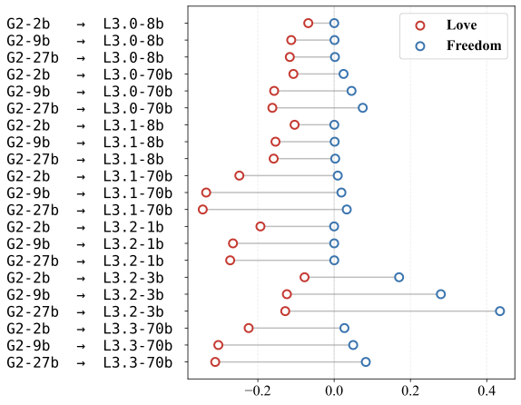

# Part D: the authors' Figure 3, reproduced and compared with results_v2

Data only. Nothing here interprets value biases.

## 1. The authors' script, run unmodified

```
cd vendor/reward_models_inherit_value_biases_from_pretraining && ../../.venv/bin/python figures/generate_figure_3.py
```

- Exit code 0, about 16 s wall time. The log is at `runs/logs/part_d_figure3.log`.
- All 10 CSVs were already present in `data/logprobs/`, so `fetch_missing_logprobs` downloaded nothing. No environment change was needed.
- Script output: `Merged on 85517 common tokens across 10 models`.
- Figure: `figures/output/fig3_lollipop.pdf`, copied to `results_v3/fig3_lollipop.pdf` and converted with `sips -s format png`.



**Vendor repo is clean.** After the run, `git status --porcelain` printed only `?? figures/output/`. That directory was already untracked before this run (it holds the Figure 2 PDFs from an earlier part). `git diff --stat` printed nothing. HEAD is `5d8d2e9d879bf0060c791b11300f0efda42c9bcf`.

## 2. The values the script computed

`scripts/survey/v3/part_d_values.py` imports `generate_figure_3.py` unchanged. It then calls `load_model_logprobs(data/logprobs, FIGURE_3_MODELS_ALL, "greatest_ever_one")` and `compute_all_mwlr_comparisons(merged)` with the default targets `('Freedom', 'Love')`, exactly as `main()` does.

- **Sign:** `compute_mwlr(llama, gemma)`. A positive value means the Llama model puts more probability on the word than the Gemma model.
- **Value per cell:** the mean of per-string MWLR over the decoded strings whose `strip().lower()` equals the word.
- **Output files:** `results_v3/part_d_authors_mwlr.csv` holds the values. `results_v3/part_d_matched_strings.csv` holds the decoded strings that were averaged.

The strings that survive the all-10 intersection:

| Word | Strings | Count |
|---|---|---|
| freedom | `Freedom`, `␣Freedom`, `␣freedom` | 3 |
| love | `Love`, `love`, `␣Love`, `␣love`, `␣LOVE` | 5 |

These Gemma strings are absent from the Llama vocabulary and therefore dropped: `freedom`, `␣FREEDOM`, `LOVE`. In the list, ␣ marks a leading space.

| Llama model | Gemma model | freedom MWLR | love MWLR |
|---|---|---|---|
| Llama-3.2-1B-Instruct | gemma-2-2b-it | -0.000053 | -0.193176 |
| Llama-3.2-1B-Instruct | gemma-2-9b-it | 0.000129 | -0.265114 |
| Llama-3.2-1B-Instruct | gemma-2-27b-it | 0.000322 | -0.272450 |
| Llama-3.2-3B-Instruct | gemma-2-2b-it | 0.170294 | -0.077563 |
| Llama-3.2-3B-Instruct | gemma-2-9b-it | 0.279757 | -0.123798 |
| Llama-3.2-3B-Instruct | gemma-2-27b-it | 0.434684 | -0.128143 |
| Meta-Llama-3-8B-Instruct | gemma-2-2b-it | 0.000299 | -0.067781 |
| Meta-Llama-3-8B-Instruct | gemma-2-9b-it | 0.001005 | -0.112455 |
| Meta-Llama-3-8B-Instruct | gemma-2-27b-it | 0.002087 | -0.116172 |
| Llama-3.1-8B-Instruct | gemma-2-2b-it | 0.000449 | -0.103637 |
| Llama-3.1-8B-Instruct | gemma-2-9b-it | 0.001375 | -0.153678 |
| Llama-3.1-8B-Instruct | gemma-2-27b-it | 0.002797 | -0.158502 |
| Meta-Llama-3-70B-Instruct | gemma-2-2b-it | 0.024675 | -0.106774 |
| Meta-Llama-3-70B-Instruct | gemma-2-9b-it | 0.045612 | -0.157220 |
| Meta-Llama-3-70B-Instruct | gemma-2-27b-it | 0.074995 | -0.161914 |
| Llama-3.1-70B-Instruct | gemma-2-2b-it | 0.009450 | -0.248443 |
| Llama-3.1-70B-Instruct | gemma-2-9b-it | 0.019089 | -0.335444 |
| Llama-3.1-70B-Instruct | gemma-2-27b-it | 0.033048 | -0.344367 |
| Llama-3.3-70B-Instruct | gemma-2-2b-it | 0.027005 | -0.223993 |
| Llama-3.3-70B-Instruct | gemma-2-9b-it | 0.049955 | -0.303512 |
| Llama-3.3-70B-Instruct | gemma-2-27b-it | 0.082984 | -0.311666 |

## 3. Comparison with results_v2 section 3 (the "authors' rule" column)

Our sign is MWLR(model, ref): a positive value means the model puts more probability on the word than the reference. Our references are our local MPS runs of gemma-2-2b-it and Llama-3.2-3B-Instruct.

Which of our cells matches which authors' pair:

| Authors' pair | Our row (results_v2) | Our reference | Sign |
|---|---|---|---|
| (Llama X, gemma-2-2b-it) | paper Llama X | local gemma-2-2b-it | as is |
| (Llama-3.2-3B-Instruct, Gemma Y) | paper Gemma Y | local Llama-3.2-3B-Instruct | flipped |

The pair (Llama-3.2-3B-Instruct, gemma-2-2b-it) has two comparable cells, one from each reference, and both are listed.

The last two columns recompute the authors' rule on two files only (pairwise intersection, their read and dedup steps). The first uses both paper files. The second swaps in our local reference, as results_v2 did. Full data: `results_v3/part_d_comparison.csv`.

**freedom**

| Llama model | Gemma model | our cell | authors (Fig. 3) | ours (v2) | ours − authors | same sign | pairwise, paper vs paper | pairwise, with local ref |
|---|---|---|---|---|---|---|---|---|
| Llama-3.2-1B-Instruct | gemma-2-2b-it | paper Llama vs local gemma-2-2b-it | -0.000053 | -0.000053 | -0.000000 | yes | -0.000053 | -0.000053 |
| Llama-3.2-3B-Instruct | gemma-2-2b-it | paper Llama vs local gemma-2-2b-it | 0.170294 | 0.170236 | -0.000059 | yes | 0.170294 | 0.170236 |
| Llama-3.2-3B-Instruct | gemma-2-2b-it | paper Gemma vs local Llama-3.2-3B, sign flipped | 0.170294 | 0.148158 | -0.022136 | yes | 0.170294 | 0.148158 |
| Llama-3.2-3B-Instruct | gemma-2-9b-it | paper Gemma vs local Llama-3.2-3B, sign flipped | 0.279757 | 0.245234 | -0.034522 | yes | 0.279757 | 0.245234 |
| Llama-3.2-3B-Instruct | gemma-2-27b-it | paper Gemma vs local Llama-3.2-3B, sign flipped | 0.434684 | 0.382932 | -0.051753 | yes | 0.434684 | 0.382932 |
| Meta-Llama-3-8B-Instruct | gemma-2-2b-it | paper Llama vs local gemma-2-2b-it | 0.000299 | 0.000298 | -0.000000 | yes | 0.000299 | 0.000298 |
| Llama-3.1-8B-Instruct | gemma-2-2b-it | paper Llama vs local gemma-2-2b-it | 0.000449 | 0.000448 | -0.000000 | yes | 0.000449 | 0.000448 |
| Meta-Llama-3-70B-Instruct | gemma-2-2b-it | paper Llama vs local gemma-2-2b-it | 0.024675 | 0.024661 | -0.000014 | yes | 0.024675 | 0.024661 |
| Llama-3.1-70B-Instruct | gemma-2-2b-it | paper Llama vs local gemma-2-2b-it | 0.009450 | 0.009446 | -0.000005 | yes | 0.009450 | 0.009446 |
| Llama-3.3-70B-Instruct | gemma-2-2b-it | paper Llama vs local gemma-2-2b-it | 0.027005 | 0.026994 | -0.000011 | yes | 0.027005 | 0.026994 |

**love**

| Llama model | Gemma model | our cell | authors (Fig. 3) | ours (v2) | ours − authors | same sign | pairwise, paper vs paper | pairwise, with local ref |
|---|---|---|---|---|---|---|---|---|
| Llama-3.2-1B-Instruct | gemma-2-2b-it | paper Llama vs local gemma-2-2b-it | -0.193176 | -0.193671 | -0.000495 | yes | -0.193176 | -0.193671 |
| Llama-3.2-3B-Instruct | gemma-2-2b-it | paper Llama vs local gemma-2-2b-it | -0.077563 | -0.077883 | -0.000320 | yes | -0.077563 | -0.077883 |
| Llama-3.2-3B-Instruct | gemma-2-2b-it | paper Gemma vs local Llama-3.2-3B, sign flipped | -0.077563 | -0.077047 | +0.000516 | yes | -0.077563 | -0.077047 |
| Llama-3.2-3B-Instruct | gemma-2-9b-it | paper Gemma vs local Llama-3.2-3B, sign flipped | -0.123798 | -0.123201 | +0.000597 | yes | -0.123798 | -0.123201 |
| Llama-3.2-3B-Instruct | gemma-2-27b-it | paper Gemma vs local Llama-3.2-3B, sign flipped | -0.128143 | -0.127708 | +0.000435 | yes | -0.128143 | -0.127708 |
| Meta-Llama-3-8B-Instruct | gemma-2-2b-it | paper Llama vs local gemma-2-2b-it | -0.067781 | -0.068094 | -0.000314 | yes | -0.067781 | -0.068094 |
| Llama-3.1-8B-Instruct | gemma-2-2b-it | paper Llama vs local gemma-2-2b-it | -0.103637 | -0.103983 | -0.000346 | yes | -0.103637 | -0.103983 |
| Meta-Llama-3-70B-Instruct | gemma-2-2b-it | paper Llama vs local gemma-2-2b-it | -0.106774 | -0.107123 | -0.000350 | yes | -0.106774 | -0.107123 |
| Llama-3.1-70B-Instruct | gemma-2-2b-it | paper Llama vs local gemma-2-2b-it | -0.248443 | -0.249049 | -0.000605 | yes | -0.248443 | -0.249049 |
| Llama-3.3-70B-Instruct | gemma-2-2b-it | paper Llama vs local gemma-2-2b-it | -0.223993 | -0.224549 | -0.000556 | yes | -0.223993 | -0.224549 |

### Agreement

- **Sign:** all 20 comparable cells (10 freedom, 10 love) have the same sign in the authors' Figure 3 and in our results_v2 table.
- **love:** the largest |ours − authors| is 0.00061, at most 0.7% of the authors' value.
- **freedom, cells using our local gemma-2-2b-it reference:** the largest |ours − authors| is 0.00006.
- **freedom, cells using our local Llama-3.2-3B-Instruct reference:** ours is lower by 0.022, 0.035 and 0.052 (13%, 12% and 12% of the authors' values) for gemma-2-2b-it, gemma-2-9b-it and gemma-2-27b-it.

### Methodological differences and what each one contributes

The maximum absolute difference each factor produces, over all 20 cells:

| Factor | What we compared | Max abs difference | Contribution |
|---|---|---|---|
| (i) All-10 vs pairwise intersection | authors' Fig. 3 value vs "pairwise, paper vs paper" | 0.0 (identical) | none |
| (ii) Local MPS reference vs authors' CUDA file | "pairwise, paper vs paper" vs "pairwise, with local ref" | 0.052 | the entire discrepancy |
| (iii) Default `read_csv` vs `keep_default_na=False` | both pairwise variants, recomputed both ways | 0.0 (identical) | none |
| Our v2 code vs the pairwise rule | results_v2 value vs "pairwise, with local ref" | 0.0 (identical) | none |

1. **(i) All-10 vs pairwise intersection: no effect on these cells.**
   - The authors' value equals the pairwise paper-vs-paper recomputation exactly in all 20 cells.
   - The intersection does shrink the full vocabulary to 85,517 strings, but every target string that one Llama-3 model and one Gemma-2 model share is shared by all 10 models. All Llama-3.x files share one tokenizer, and so do all Gemma-2 files.
   - So the same 3 freedom strings and 5 love strings are averaged either way.
2. **(ii) Local MPS reference vs the authors' CUDA file: the whole discrepancy.**
   - Recomputing the authors' rule pairwise, with our local reference in place of the paper file, reproduces the results_v2 value exactly in all 20 cells.
   - The log-prob shifts (local − paper) behind it, on `greatest_ever_one`:

     | Reference | Strings | Shift |
     |---|---|---|
     | Llama-3.2-3B-Instruct | `Freedom` | −0.118 (−1.800 → −1.918) |
     | Llama-3.2-3B-Instruct | `␣Freedom` | −0.368 |
     | Llama-3.2-3B-Instruct | `␣freedom` | +0.038 |
     | Llama-3.2-3B-Instruct | `␣Love`, `␣LOVE`, `love`, `␣love` | −0.49, −0.56, −0.37, −0.09 |
     | Llama-3.2-3B-Instruct | `Love` | +0.007 |
     | gemma-2-2b-it | most target strings | +0.0019 |
     | gemma-2-2b-it | `␣freedom` | +0.09 |
     | gemma-2-2b-it | `␣Freedom` | +0.033 |

   - The large freedom gaps occur only in the cells that use the local Llama-3.2-3B reference.
   - The results_v2 self-comparison of the paper's Llama-3.2-3B-Instruct against our local copy shows the same thing directly: freedom 0.0062, love −0.0005 under the authors' rule (results_v2 section 3, reference Llama-3.2-3B-Instruct table).
3. **(iii) Default `read_csv` vs `keep_default_na=False`: no effect.**
   - Every recomputation was run both ways, and the values are identical.
   - The strings that default `read_csv` turns into NaN (`null`, `None`, `NA`, `nan`, ...) never match `freedom` or `love`.
4. **(iv) Other code differences found:**
   - **Restricted dedup:** our `mwlr_authors` (`scripts/survey/v2/measures.py`) dedups and intersects only the rows whose `strip().lower()` is a target. The authors dedup and intersect the full vocabulary. The resulting set of target strings is the same.
   - **Zero probabilities:** our `_mwlr` returns NaN when either probability is 0 and averages with `nanmean`. The authors use plain `mean`. No target string has zero probability here, so this has no effect.
   - **Normalisation:** neither implementation sums variants. The authors' value is a mean over strings, not MWLR of summed mass. Our separate "merged" column in results_v2 (summed variant mass) is a different quantity and is not compared here.
   - **Duplicate strings:** both keep the maximum log-prob per duplicated decoded string.
   - All four were confirmed numerically: the "ours (v2)" and "pairwise, with local ref" columns are identical.

## Files

- `runs/logs/part_d_figure3.log`: stdout and stderr of the unmodified script.
- `results_v3/fig3_lollipop.pdf` and `results_v3/fig3_lollipop.png`: the figure.
- `results_v3/part_d_authors_mwlr.csv`: the authors' MWLR, all 21 (Llama, Gemma) pairs.
- `results_v3/part_d_matched_strings.csv`: the target strings in the all-10 merge, with each model's log-prob.
- `results_v3/part_d_comparison.csv`: the comparison and decomposition columns.
- `scripts/survey/v3/part_d_values.py`: code for sections 2 and 3. It reads the CSVs and `results_v2/tables.pkl` only.
